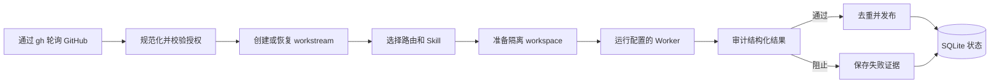

# Robert

<p align="center">
  
</p>

[English](README_EN.md) | [简体中文](README.md)

**Your Repo Teammate**

An AI teammate that takes care of your GitHub work.

Robert 是一个自托管的 GitHub 队友。它把可信的 Issue、提及、指派、评审和
后续评论转换为受控的编码代理任务，并通过 Git worktree、审计门禁和 SQLite
持久状态保证无人值守运行仍然可检查、可恢复。Robert 是运行在本机的 GitHub
协作控制面：它发现事件、校验信任关系、选择路由和 Worker、监督执行、审计
计划中的 GitHub 动作，并只发布路由允许的动作。

编码代理本身不能解决授权、并发、去重、失败恢复和证据留存。Robert 将这些
约束做成稳定协议，不需要 GitHub App，也不需要托管控制服务。Robert
`0.1.0b2` 是公开 Beta，当前只使用轮询获取 GitHub 事件，稳定版之前接口仍
可能调整。

## 功能特性

- **GitHub 协作闭环**：处理可信的 Issue、PR、评审、指派、提及和后续评论，
  从需求分析、创建 PR 到评审修改持续跟进；同一 workstream 串行执行并保留上下文。
- **多仓库与隔离执行**：每个仓库独立配置 checkout、worktree 根目录、可信 Actor、
  并发限制和路由覆盖，通过 Git worktree 隔离分析、实现与源码评审。
- **多种编码 Agent**：内置 `codex`、`tcodex`、`claude`、`tclaude`、`opencode`、
  `cbc` 和通用 `command` 适配器。可按路由选择 Worker、模型、推理 effort 和 Skill；
  缺少必需 Skill 时，在创建 worktree 和启动 Worker 前阻止任务。
- **执行监督与恢复**：记录执行阶段、心跳、日志和每次尝试，监督启动、超时与进程清理；
  可配置连续超时后的备用模型，失败后保留原因与恢复入口。
- **PR 自修复**：按仓库显式开启 CI 失败修复和冲突合并，限制检查名称、重试次数及预算。
  发布前再次核对 PR head/base，只允许普通 push。
- **任务生命周期看板**：从待整理、排队、执行、需要处理到待评审、完成和取消，
  展示阶段、执行历史、产物及发布记录。显式开启写入后，可提交本地任务、回复、
  重试执行、重试发布和取消；操作仍受权限、状态与幂等校验约束。
- **无人值守运行**：推荐 Supervisor 分别管理 daemon 和 Web，提供自动重启、状态查询和日志；
  也支持 systemd 用户服务及 macOS LaunchAgent。
- **可审计的持久状态**：SQLite 保存任务、尝试、审核结果和发布去重记录；提供诊断历史保留策略、
  脱敏诊断导出，以及可选的 OpenClaw 只读查询。

## 工作流程



Robert 使用已认证的 `gh` CLI 轮询 GitHub，规范化事件，应用仓库级信任规则，
创建或恢复 workstream，准备任务目录，启动本地 Worker，审计结构化结果，并
在发布前执行去重。

整体架构、模块关系及复杂机制的流程图和时序图见
[架构与运行机制](docs/architecture.md)。

## 环境要求

- Linux 或 macOS；Windows 通过 WSL 使用。
- Python 3.10 或更高版本。
- Git 和已登录的 GitHub CLI。
- 至少一个本地 Worker 命令。
- 推荐使用 `pipx` 安装。

## 使用编码 Agent 安装

把下面的提示词复制给 Codex、Claude Code 或其他终端编码 Agent：

```text
Install and fully configure Robert on this machine by following:
https://github.com/wklken/Robert/blob/main/docs/agent-install.md

Read the entire guide before executing. Ask me for required values and for
confirmation wherever the guide requires it.
```

## 配置

Robert 使用 `version: 1` 的 YAML，默认位于 `~/.config/robert/config.yml`。
`github` 配置监听账号，`workers` 定义编码 Agent，`routes` 与 `route_worker_models`
配置路由及模型，`repos` 定义仓库与信任关系，`daemon` 配置轮询及诊断保留策略。
任务执行统一使用 SQLite 状态机，不需要 DBOS 或 PostgreSQL。旧 `legacy` 配置作为
SQLite 的兼容输入接受；旧 `active` / `shadow` 部署须先按[升级指南](docs/sqlite-state-machine-upgrade.md)
完成离线交接，不能仅修改模式后直接启动。

完整结构、字段默认值与旧配置调整见[配置参考](docs/reference.md#configuration)，
安装与多仓库示例见[操作指引](docs/guides.md)。
Worker 可配置 `fallback_model`；同一 workstream 连续两次
`failed_timeout` 后，第三次运行切换到该模型，推理 effort 保持不变。默认硬超时为
45 分钟。
CI 和冲突修复默认关闭；只有仓库配置中的 `pr_automation` 显式启用后才运行，
CI 还必须配置非空 `check_allowlist`。

## 守护进程

推荐使用 [Supervisor 同时管理 daemon 和 Web](docs/guides.md#daemon-service)。
完成配置和检查后启动，并确认两个进程都为 `RUNNING`：

```bash
supervisord -c ~/.config/robert/supervisord.conf
supervisorctl -c ~/.config/robert/supervisord.conf status
```

两个进程共用同一份 Robert 配置。Web 负责展示与提交操作，后台 daemon 负责调度执行。
前台调试分别使用 `robert daemon run` 和 `robert web run`。
`robert service install` 会自动选择 systemd、launchd 或 Linux 的 Supervisor 后端，
具体差异见操作指引。

## 本地 Web UI


```bash
robert web run
```

默认模式只读且仅监听本机。写入模式必须显式开启：

```bash
robert web run --writable --operator "$USER"
```

非回环地址还必须使用 `--allow-remote`，并部署经过认证的反向代理。

首页以看板展示任务生命周期。执行进度、失败恢复、取消和发布重试见
[任务生命周期看板](docs/web-lifecycle-board.md)。

## OpenClaw 集成


```bash
robert openclaw install
robert openclaw status
```

插件只提供 Robert 状态、任务、运行和产物查询，不会启动 Robert，也不会创建
定时任务。

## 故障排查

先运行 `robert doctor --output json`，并用
`supervisorctl -c ~/.config/robert/supervisord.conf status` 检查两个进程。
使用原生服务时检查 `robert service status`。需要提供诊断信息时，生成经过脱敏的压缩包：

```bash
robert diagnostics export --output robert-diagnostics.zip
```

不要在公开 Issue 中上传凭证或私有仓库内容。

## 参与贡献

阅读 [COMMUNITY.md](COMMUNITY.md) 并执行其中的验证命令。首个 Beta
不强制 DCO 签署，也不要求 CLA。

## 安全与信任模型

GitHub 文本始终按不可信输入处理。只有配置中的可信 Actor 能触发工作。仓库
覆盖不能改变路由的 GitHub 权限和 workspace 策略。Worker 环境变量采用白名单，
配置文件不保存 GitHub Token，所有对外文本都经过脱敏和审计。Web UI 默认绑定
`127.0.0.1`。

## 许可证

Apache License 2.0，详见 `LICENSE`。
