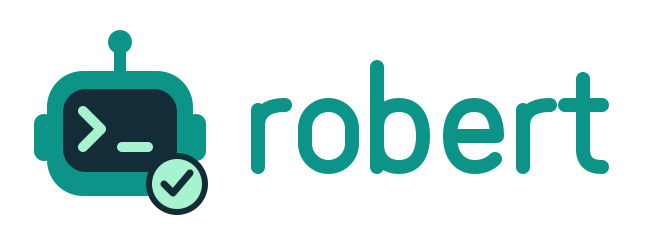
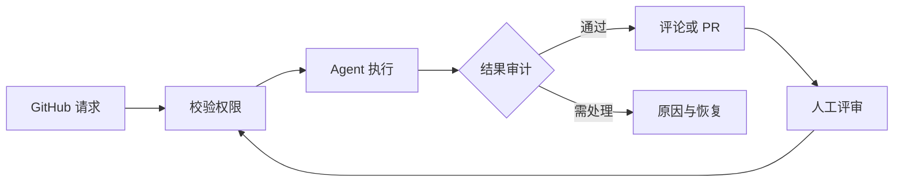
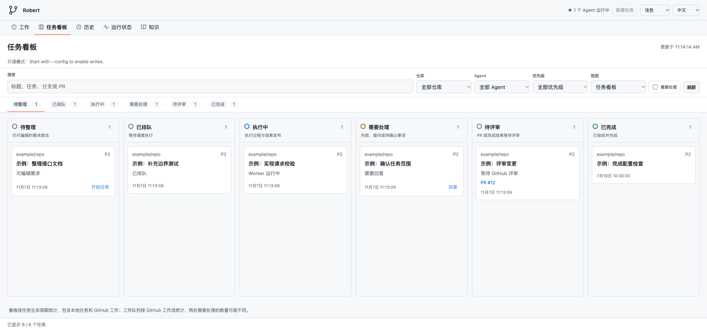

# Robert

<p align="center">
  
</p>

[English](README_EN.md) | [简体中文](README.md) | [文档目录](docs/README.md)

**Your Repo Teammate**

An AI teammate that takes care of your GitHub work.

**在 GitHub 上交代任务，让你自己的编码 Agent 分析问题、提交 PR、跟进评审。**

Robert 运行在你自己的 Linux 或 macOS 机器上。它持续关注指定仓库，把可信用户的请求
交给本地 Codex、Claude Code 等 Agent 执行，并记录进度、检查结果和发布记录。
你可以在 GitHub 继续讨论，也可以在本地看板查看任务卡在哪里、需要谁处理。

[手工安装](docs/human-install.md) · [让 Agent 安装](docs/agent-install.md) ·
[完成第一个任务](docs/first-task.md) · [常见问题](docs/troubleshooting.md)

> 项目处于 Beta 阶段。这里描述的是当前分支的能力，可能领先于 PyPI 发布版。
> 安装时请[选择匹配的代码与文档版本](docs/human-install.md#choose-version)；
> 发布记录见 [Releases](https://github.com/wklken/Robert/releases) 和 [CHANGELOG](CHANGELOG.md)。

## 可以帮你做什么

在已配置仓库的 Issue 或 PR 中，用可信账号 `@你的机器人账号`：

| 你交代的工作 | Robert 的处理方式 |
| --- | --- |
| “分析这个报错的原因，先不要改代码” | 阅读代码与讨论，回复分析结论 |
| “修复这个问题，补充测试并提交 PR” | 创建独立工作区，调用 Agent 修改、验证，审计通过后提交 PR |
| “评审这个 PR，重点看兼容性” | 检查 PR 源码并发布评审意见 |
| “根据这条评审意见继续修改” | 在对应 PR 的任务中继续跟进并更新分支 |
| 管理多个仓库的任务 | 分别配置可信用户、Agent、并发与工作目录，在同一看板查看进度 |

具体触发方式、示例与成功判据见[第一个任务](docs/first-task.md)。
不是每条 Issue 都会触发工作：需要匹配配置中的仓库、可信用户和触发条件。

以下能力需要额外配置：

- [多模型 PR 评审](docs/multi-model-review.md)：按 PR 作者白名单启用多个评审 Worker。
- [多 Agent 投票](docs/multi-agent-vote.md)：响应可信用户的显式投票请求。
- [CI 与冲突修复](docs/reference.md#configuration)：按仓库启用，限制检查名称、次数与预算，默认关闭。
- [持续任务监督](docs/task-supervision.md)：观察停滞与交付证据，诊断和恢复按策略启用。
- [OpenClaw 消息](docs/operator-messaging.md)：接收提问和故障通知，提交受权限约束的回复。

## 它如何工作



Robert 负责接单、调度、监督和发布；**编码 Agent 负责理解代码和完成工作**。
它使用已认证的 `gh` CLI 轮询 GitHub，不需要 GitHub App 或 Webhook。
任务与执行记录保存在本地 SQLite 中，修改代码使用 Git worktree。
详细机制见[核心概念](docs/concepts.md)和[架构图](docs/architecture.md)。

## 看见进度和结果



*看板示例使用隔离演示数据，展示排队、执行、需要处理、待评审等状态。*

Web 默认只读，绑定 `127.0.0.1:8765`。开启写入模式后，可提交本地任务、回复、
重试或取消；具体操作见[生命周期看板](docs/web-lifecycle-board.md)。
**看板运行不等于任务会执行：后台 daemon 也必须运行。**

## 开始使用

需要 Linux / macOS（Windows 使用 WSL）、Python 3.11–3.15、Git、已认证的 GitHub CLI，
以及至少一个已安装、已登录且可用的编码 Agent。模型使用自己的账号与配额，Robert 不提供模型服务。

### 手工部署

按[手工安装指南](docs/human-install.md)依次完成：

1. 选择代码版本，安装 Robert。
2. 准备目标仓库、GitHub 账号与可信触发者。
3. 生成并检查配置，运行 `robert doctor` 和离线预览。
4. 用 Supervisor 启动 daemon 与 Web，再[验证首个任务](docs/first-task.md)。

### 让编码 Agent 部署

将下面的提示词复制给 Codex、Claude Code 或其他终端 Agent：

```text
Install and fully configure Robert on this machine by following:
https://github.com/wklken/Robert/blob/main/docs/agent-install.md

Read the entire guide before executing. Match the installed code to the guide's
revision. Ask me for missing deployment values. Prepare and validate first;
obtain explicit confirmation before starting unattended operation or live tests.
Report what was verified and what still needs a real task.
```

## 适用范围与边界

- 适合希望在自己的机器上持续处理 GitHub 工作、并愿意配置账号和本地 Agent 的个人或团队。
- 当前通过轮询获取事件，响应受扫描间隔、GitHub 配额和模型运行时间影响，不保证即时响应。
- Git worktree 隔离代码目录，**不提供操作系统沙箱**。请使用专用账号或受控运行环境。
- 只有可信用户能触发受保护工作；结果发布还须通过路由权限、审计与去重检查。
- 默认 Web 没有面向公网的用户登录系统。远程访问需要经过认证的反向代理。
- 自动化结果仍需人工评审。不要把“Agent 已完成”当成“PR 已合并”。

信任和凭证边界见 [SECURITY.md](SECURITY.md)。

## 文档与社区

| 我想…… | 入口 |
| --- | --- |
| 安装、检查并跑通一个任务 | [手工安装](docs/human-install.md) / [Agent 安装](docs/agent-install.md) / [第一个任务](docs/first-task.md) |
| 配置其他 Agent、多仓库或后台服务 | [操作指引](docs/guides.md) / [配置与命令参考](docs/reference.md) |
| 处理启动失败、任务不动或发布失败 | [故障排查](docs/troubleshooting.md) / [支持渠道](SUPPORT.md) |
| 参与开发或改进文档 | [贡献指南](CONTRIBUTING.md) / [行为准则](CODE_OF_CONDUCT.md) |
| 报告安全问题 | [私密报告流程](SECURITY.md#reporting-a-vulnerability) |

Apache License 2.0，详见 [LICENSE](LICENSE)。
