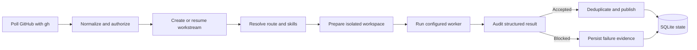
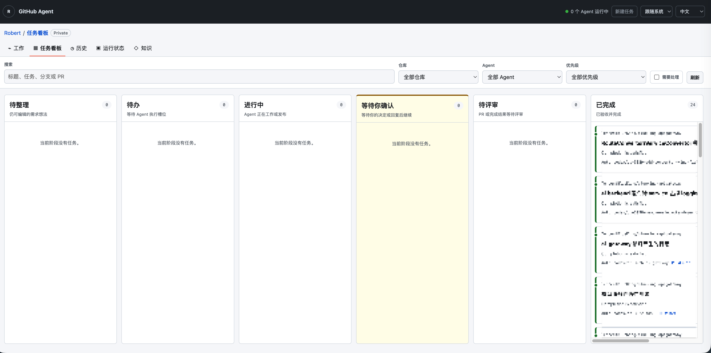
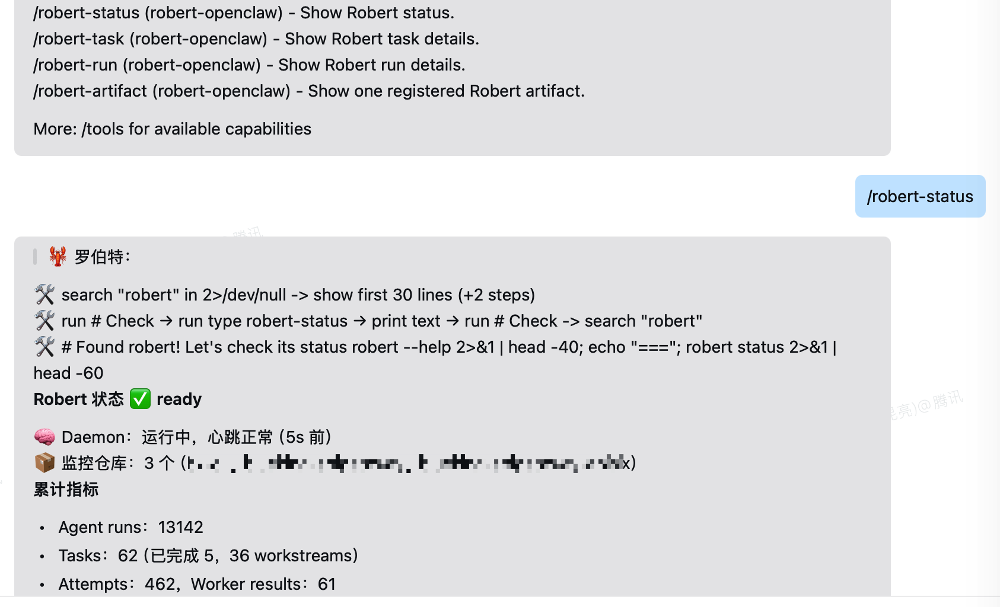

# Robert

<p align="center">
  
</p>

[English](README_EN.md) | [简体中文](README.md)

**Your Repo Teammate**

An AI teammate that takes care of your GitHub work.

Robert is a self-hosted GitHub teammate that turns trusted issues, mentions,
assignments, reviews, and follow-up comments into controlled coding-agent work.
It coordinates local workers, isolates repository work in Git worktrees,
audits proposed GitHub actions, and stores durable workstream state in SQLite.

## What Robert Is

Robert is a local control plane for trusted GitHub collaboration. It discovers
authorized work, routes it to a configured worker, supervises execution, audits
the proposed GitHub actions, and publishes only actions allowed by the route.

## Why Robert Exists

Coding agents are useful, but unattended GitHub automation needs durable state,
clear trust boundaries, isolated workspaces, deduplication, and evidence.
Robert provides those controls without requiring a GitHub App or hosted service.

## Key Capabilities

- **GitHub collaboration:** handle trusted issues, pull requests, reviews,
  assignments, mentions, and follow-up comments, from analysis and PR creation
  through review updates, with one active task per workstream.
- **Multiple repositories and isolated work:** configure each repository's
  checkout, worktree root, trusted actors, concurrency, and route overrides.
  Analysis, implementation, and source review use isolated Git worktrees.
- **Multiple coding agents:** built-in `codex`, `tcodex`, `claude`, `tclaude`,
  `opencode`, `cbc`, and generic `command` adapters, with route-specific workers,
  models, effort, and skills. Missing required skills block before execution.
- **Execution supervision and recovery:** retain phases, heartbeats, logs, and
  attempt history; supervise startup, timeouts, and process cleanup; optionally
  select a fallback model after consecutive timeouts.
- **Opt-in PR self-healing:** repair allowlisted CI failures and merge exact base
  snapshots into conflicting PRs within configured attempt and budget limits.
  Publication rechecks the PR head/base before an ordinary non-force push.
- **Lifecycle task board:** show intake, queueing, execution, attention, review,
  completion, and cancellation, with artifacts and publication history. Explicit
  writable mode enables local tasks, replies, execution/publication retries,
  and cancellation under permission, state, and idempotency checks.
- **Unattended operation:** recommended Supervisor management for both daemon
  and web processes, with restart, status, and logs; native systemd user services
  and macOS LaunchAgents are also supported.
- **Durable, auditable state:** SQLite task, attempt, audit, and deduplication
  records, diagnostic retention, redacted support exports, and optional read-only
  OpenClaw commands.

## How It Works



Robert polls GitHub through the authenticated `gh` CLI, normalizes events,
checks repository-specific trust rules, creates or resumes a workstream, selects
a route, prepares a task workspace, launches a local worker, audits its
structured result, and deduplicates approved GitHub actions before publication.

See the [architecture and mechanism diagrams (Chinese)](docs/architecture.md)
for component relationships, control flows, and sequences for complex mechanisms.

## Security and Trust

GitHub text is untrusted input. Only configured actors can trigger work.
Repository overrides cannot change immutable route permissions or workspace
policy. Worker environments use an allowlist, credentials are never stored in
Robert configuration, and GitHub-facing text passes the redaction and audit
gates. The web UI binds to `127.0.0.1` by default.

## Requirements

- Linux or macOS. Windows is supported through WSL.
- Python 3.10 or newer.
- Git and GitHub CLI (`gh`) with an authenticated session.
- At least one local worker command such as Codex.
- `pipx` is recommended for installation.

## Quick Start

```bash
pipx install robert-github-agent --include-deps
gh auth login
robert init
robert config validate
robert doctor
```

The configuration is written to `~/.config/robert/config.yml`. Runtime data is
stored under `~/.local/share/robert/`. Then follow the
[Supervisor setup](docs/guides.md#daemon-service) to run both daemon and web.

## Install with a Coding Agent

Copy this prompt into Codex, Claude Code, or another terminal coding agent:

```text
Install and fully configure Robert on this machine by following:
https://github.com/wklken/Robert/blob/main/docs/agent-install.md

Read the entire guide before executing. Ask me for required values and for
confirmation wherever the guide requires it.
```

## Configuration

PR self-healing is disabled by default. Enable `pr_automation` on an individual
repository; CI automation also requires a non-empty `check_allowlist`.

Robert uses `version: 1` YAML at `~/.config/robert/config.yml`. The main sections
are `github`, `workers`, `skills`, `routes`, `route_worker_models`, `repos`,
`daemon`, and optional `workflow_engine`. SQLite is the only execution engine;
`legacy` is accepted as a deprecated alias. Existing DBOS deployments must follow
the [offline upgrade procedure](docs/sqlite-state-machine-upgrade.md) before switching.
See the [configuration reference](docs/reference.md#configuration) for structure,
defaults, and older configuration updates, and [guides](docs/guides.md) for examples.
Workers may define `fallback_model`. After two consecutive `failed_timeout`
attempts in the same workstream, the third run uses that model without changing
the reasoning effort. The default hard timeout is 45 minutes.

## Worker Adapters

Built-in adapters support `codex`, `tcodex`, `claude`, `tclaude`, `opencode`,
`cbc`, and a generic `command` adapter. A worker definition chooses its
adapter, executable, default and fallback models, effort, timeout, prompt transport, and
environment-variable allowlist.

## Route Skills

Each route can declare required and recommended skills. Missing required skills
block that task before a worktree or worker is created. Missing recommended
skills appear in doctor output but do not block execution.

## Multiple Repositories

Each repository has its own checkout, worktree root, trusted actors, concurrency
limit, and optional route overrides. A failure in one repository does not stop
other repository pipelines in the same cycle.

## Daemon Service

Use [Supervisor to manage both daemon and web](docs/guides.md#daemon-service).
After preparing the configuration and checking readiness:

```bash
supervisord -c ~/.config/robert/supervisord.conf
supervisorctl -c ~/.config/robert/supervisord.conf status
```

Both processes must report `RUNNING` and use the same Robert configuration.
The web process displays state and submits requests; the daemon schedules work.
For foreground debugging, use `robert daemon run` and `robert web run`.
`robert service install` automatically selects systemd, launchd, or the Linux
Supervisor fallback; see the guide for backend differences.

## Local Web UI



```bash
robert web run
```

The default server is local and read-only. Writable mode requires:

```bash
robert web run --writable --operator "$USER"
```

Non-loopback binding also requires `--allow-remote` and an authenticated reverse
proxy. See the [lifecycle board guide](docs/web-lifecycle-board.md) for progress,
execution history, cancellation, and recovery controls.

## OpenClaw



```bash
robert openclaw install
robert openclaw status
```

The optional plugin exposes read-only Robert status, task, run, and artifact
commands. It never schedules or starts Robert.

## Migration

Preview and import legacy state:

```bash
robert migrate dd-github-agent --dry-run
robert migrate dd-github-agent
```

Migration creates a separate backup and preserves legacy deduplication markers.

## Troubleshooting

Run `robert doctor --output json` and check both programs with
`supervisorctl -c ~/.config/robert/supervisord.conf status` (or
`robert service status` for native services). Export a redacted support archive with:

```bash
robert diagnostics export --output robert-diagnostics.zip
```

Do not attach private repository content or credentials to public issues.

## Contributing

Read [COMMUNITY.md](COMMUNITY.md) and run the documented verification commands.
Robert does not require DCO sign-off or a CLA for the first beta.

## Project Status

Robert `0.1.0b2` is a public beta. Polling is the only GitHub event transport in
this release. Interfaces may evolve before the first stable release.

## License

Apache License 2.0. See `LICENSE`.
