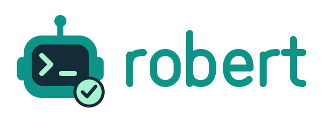
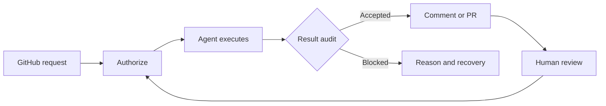
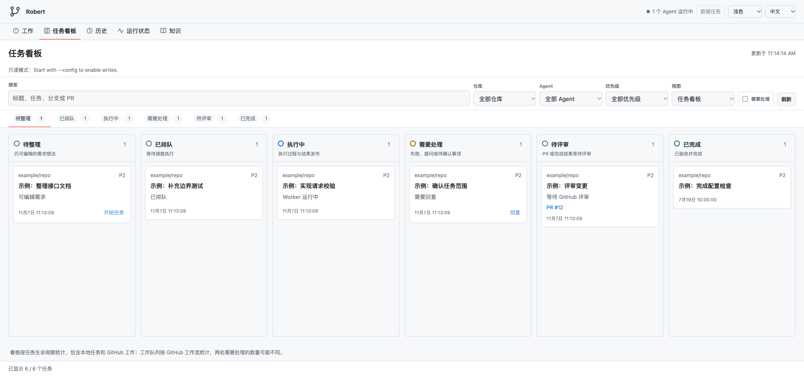

# Robert

<p align="center">
  
</p>

[English](README_EN.md) | [简体中文](README.md) | [Documentation](docs/README.md)

**Your Repo Teammate**

An AI teammate that takes care of your GitHub work.

**Give your coding agent work on GitHub: investigate issues, open PRs, and follow up on reviews.**

Robert runs on your own Linux or macOS machine. It watches configured repositories,
turns trusted requests into work for local agents such as Codex and Claude Code,
and records progress, verification, and publication. Continue the conversation on
GitHub or use the local board to see what needs attention.

[Manual installation (中文)](docs/human-install.md) · [Agent-led installation](docs/agent-install.md) ·
[First task (中文)](docs/first-task.md) · [Troubleshooting (中文)](docs/troubleshooting.md)

> Robert is in beta. This branch's documentation may describe capabilities newer
> than the PyPI package. [Match code and documentation](docs/human-install.md#choose-version)
> when installing; see [Releases](https://github.com/wklken/Robert/releases) and [CHANGELOG](CHANGELOG.md).

## What you can delegate

Mention your configured bot account from a trusted account in a configured repository:

| Your request | Robert's role |
| --- | --- |
| “Investigate this error; do not change code yet.” | Read code and discussion, then publish an analysis comment. |
| “Fix this issue, add tests, and open a PR.” | Run the agent in a separate worktree, verify and audit its result, then open a PR. |
| “Review this PR for compatibility problems.” | Inspect the PR source and publish review feedback. |
| “Address this review comment.” | Continue the corresponding PR task and update its branch. |
| Coordinate work across repositories. | Configure trust, workers, concurrency, and directories per repository; inspect one board. |

See the [first-task walkthrough (中文)](docs/first-task.md) for triggers and evidence of success.
An arbitrary issue does not automatically start work: repository, actor, and trigger must match.

## Features

- **GitHub collaboration:** follow issues through analysis, implementation, PR creation, review, and revisions in the existing discussion.
- **Multiple coding agents:** use Codex, Claude Code, OpenCode, `tcodex`, `tclaude`, `cbc`, or a custom command; select agents, models, and skills by task type. See [worker configuration](docs/guides.md#worker-adapters).
- **Multiple repositories and separate workspaces:** configure trust, concurrency, and directories per repository; use Git worktrees for edits and serialize work on each issue or PR.
- **Task board:** inspect queues, progress, attention states, logs, and artifacts; enable writable mode for local tasks, replies, retries, and cancellation. See the [board guide (中文)](docs/web-lifecycle-board.md).
- **Execution supervision and recovery:** track phases, heartbeats, and attempts; handle startup failures, timeouts, and process cleanup, with optional fallback models and visible recovery options.
- **Multi-model review and voting:** opt into [PR-author-gated reviews](docs/multi-model-review.md) or explicit [voting requests](docs/multi-agent-vote.md) from trusted users.
- **Independent task supervision:** observe stalls and delivery evidence, with policy-controlled model diagnosis, recovery decisions, and engineering repairs. See [supervision](docs/task-supervision.md).
- **PR self-healing:** opt into repository-specific CI failure and conflict repair with check allowlists, attempt limits, and budgets; disabled by default. See [configuration](docs/reference.md#configuration).
- **Unattended operation:** manage daemon and Web with Supervisor, or use systemd and macOS LaunchAgents; persist tasks, audit records, and publication deduplication in local SQLite. See [service setup](docs/guides.md#daemon-service).
- **OpenClaw integration:** query task and runtime status; explicitly enable messaging for questions, failure notices, and authenticated responses. See [messaging](docs/operator-messaging.md).

## How it works



Robert handles intake, scheduling, supervision, and publication. **Your coding
agent does the coding.** Robert polls GitHub using an authenticated `gh` CLI;
no GitHub App or webhook receiver is required. SQLite holds local task history,
and Git worktrees separate code changes. See [concepts](docs/concepts.md) and
[architecture diagrams (中文)](docs/architecture.md) for details.

## See progress and results



*The screenshot uses isolated demonstration data to show queued, running,
attention, and review states.*

Web is read-only on `127.0.0.1:8765` by default. Explicit writable mode enables
local tasks, replies, retries, and cancellation under state and authority checks.
See the [board guide (中文)](docs/web-lifecycle-board.md).
**A running web server needs a running daemon to execute tasks.**

## Get started

You need Linux or macOS (WSL on Windows), Python 3.11–3.15, Git, authenticated
GitHub CLI, and an installed, authenticated coding agent. Model access and usage
come from your own provider account; Robert does not supply a model service.

For manual setup, follow the [installation guide (中文)](docs/human-install.md):
select a version, prepare the repository and accounts, validate configuration,
then start daemon and Web with [Supervisor](docs/guides.md#daemon-service).

For agent-led setup, copy this prompt into a terminal coding agent:

```text
Install and fully configure Robert on this machine by following:
https://github.com/wklken/Robert/blob/main/docs/agent-install.md

Read the entire guide before executing. Match the installed code to the guide's
revision. Ask me for missing deployment values. Prepare and validate first;
obtain explicit confirmation before starting unattended operation or live tests.
Report what was verified and what still needs a real task.
```

## Scope and limits

- For individuals and teams who want self-hosted GitHub automation and can operate local agents.
- Polling, GitHub quotas, and model execution affect response time; replies are not instantaneous.
- Git worktrees separate directories; **they are not OS sandboxes**. Use a dedicated account or controlled environment.
- Trusted actors may trigger work; publication still requires route permissions, audit, and deduplication.
- Web has no public-facing user login system. Remote access needs an authenticated reverse proxy.
- Review generated work. Agent completion, publication, and PR merge are separate events.

See [SECURITY.md](SECURITY.md) for credentials and trust boundaries.

## Documentation and community

- [Documentation index](docs/README.md), [operations](docs/guides.md), and [configuration reference](docs/reference.md).
- [Support](SUPPORT.md) for usage questions and reproducible defects.
- [Contributing](CONTRIBUTING.md) and [Code of Conduct](CODE_OF_CONDUCT.md).
- [Private vulnerability reporting](SECURITY.md#reporting-a-vulnerability).

Licensed under [Apache License 2.0](LICENSE).
