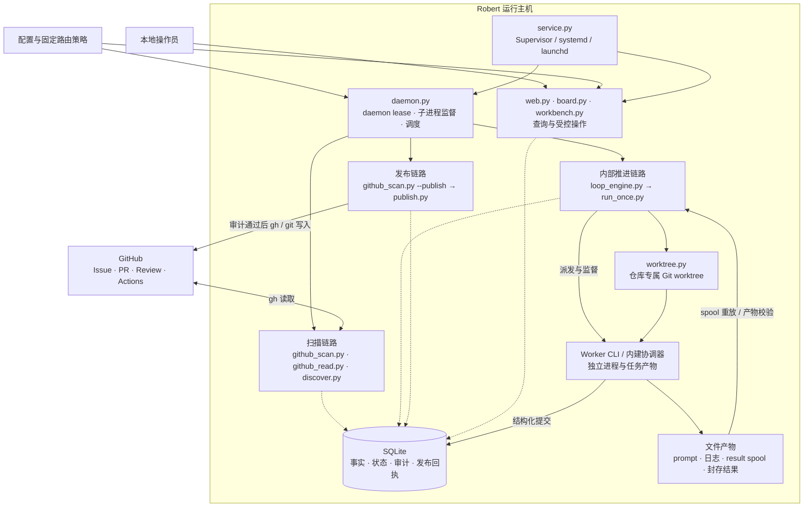
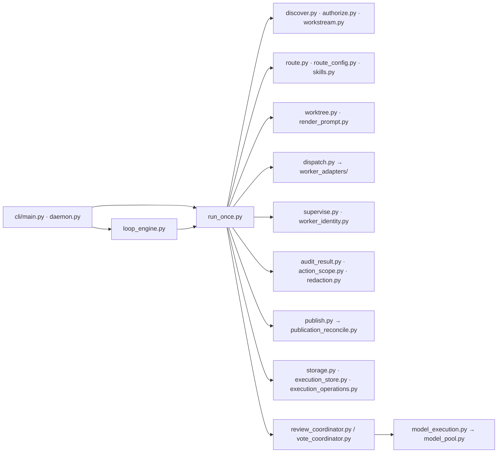
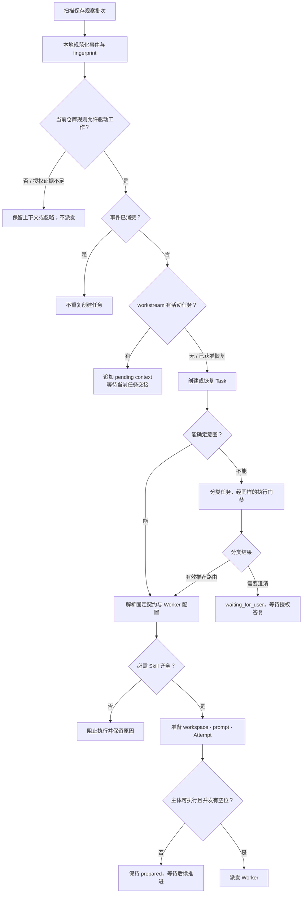
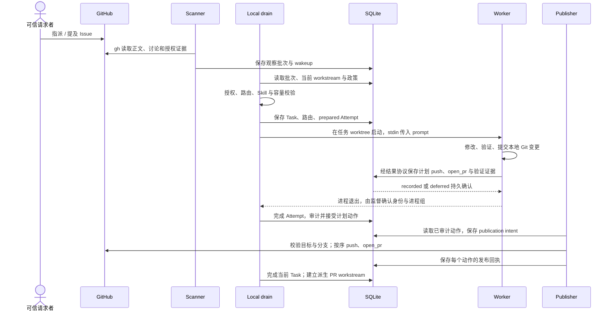
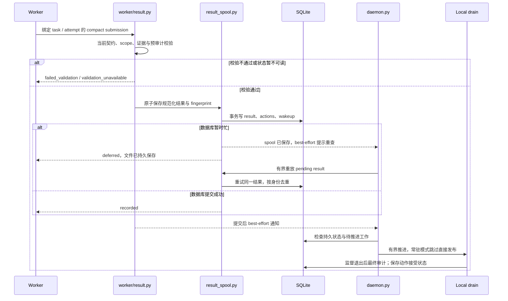
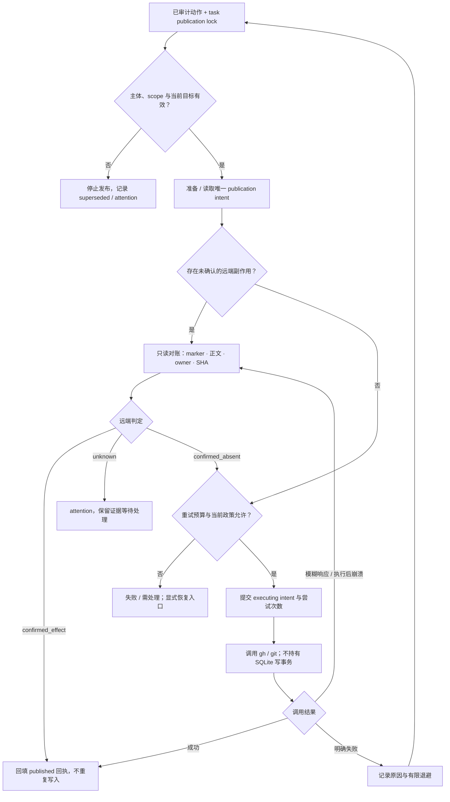
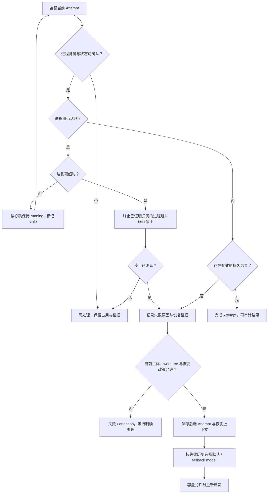
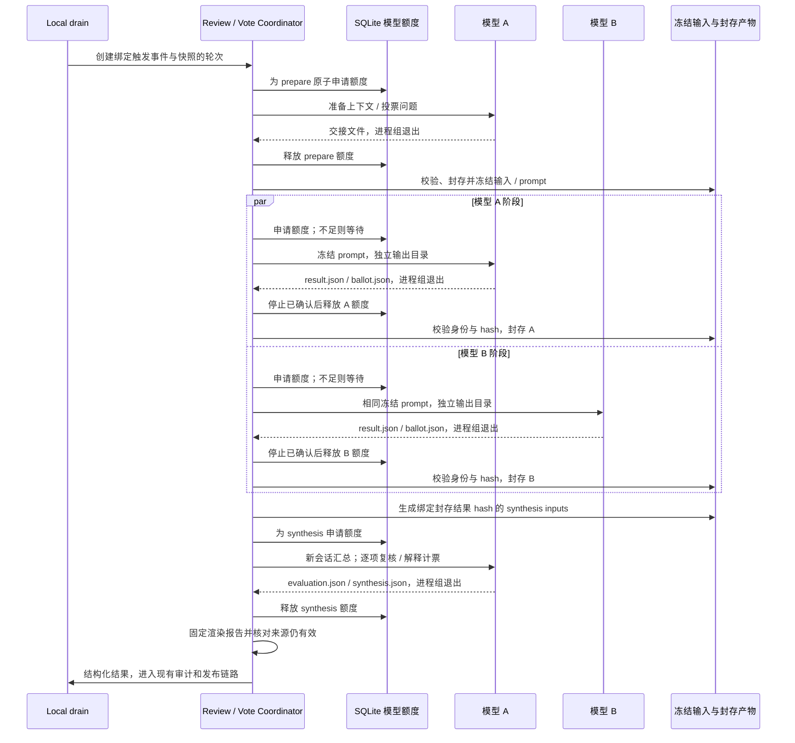
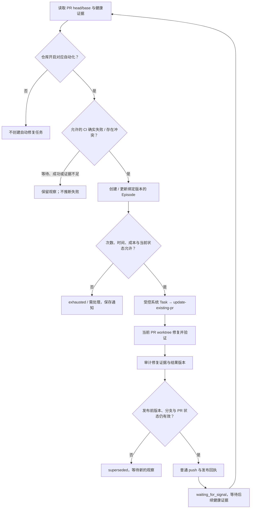
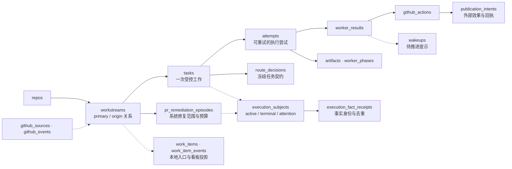

# Robert 架构与运行机制

Robert 是运行在本机的 Python 控制面。GitHub 和本地操作提供输入，编码 Worker
完成受限任务，控制面负责授权、调度、监督、审计和发布，SQLite 保存可恢复的事实。

本文按 **2026-10-31、源码提交 `06fb28b7a22a9615a5781c5a4a82688c086de6fc`**
核对实现。Mermaid 图可直接在 GitHub 阅读。箭头的含义在各图前说明；省略通用日志
和工具函数。先看整体架构与模块表，再按问题进入机制图：

- [整体架构](#整体架构)与[模块关系](#模块关系)
- [事件授权、串行协作与路由](#事件授权串行协作与路由)
- [Issue 到 PR 的时序](#issue-到-pr-的时序)
- [结果提交、唤醒与内部推进](#结果提交唤醒与内部推进)
- [发布去重与崩溃恢复](#发布去重与崩溃恢复)
- [Worker 监督与失败恢复](#worker-监督与失败恢复)
- [多模型评审与投票](#多模型评审与投票)
- [PR 自修复](#pr-自修复)
- [核心数据关系](#核心数据关系)

## 整体架构

常驻 daemon 监督扫描和发布子进程，并调用有界的内部推进链路。实线表示主要调用
或数据交接，虚线表示共享持久状态；SQLite 节点概括各组件读写。

`robert daemon run` 使用三条链路；`robert daemon run --once` 和 `robert run once`
保留同步诊断路径。[轮询机制](github-polling.md)说明缓存、API 配额、观察批次和恢复。

Git worktree 负责工作目录与分支隔离。模型 CLI 以 Robert 服务账户的权限直接运行，
worktree 和文件 hash 校验不提供操作系统沙箱。Worker 按协议只提交计划动作，
对 GitHub 的实际写入由审计后的 publisher 执行。

源码：[常驻调度](../src/robert_agent/daemon.py)（`_background_decision`、`_resident_loop`）、
[控制子进程](../src/robert_agent/control_lane.py)、[扫描与发布入口](../src/robert_agent/github_scan.py)、
[服务生成](../src/robert_agent/service.py)。

## 模块关系

箭头表示主要调用关系，节点按责任分组，不表示全部 Python import。
`run_once.py` 编排业务，政策、资源和外部动作由各模块分别负责。

| 责任 | 主要模块 | 关键契约 |
| --- | --- | --- |
| 外部发现 | [github_scan.py](../src/robert_agent/github_scan.py)、[github_read.py](../src/robert_agent/github_read.py)、[discover.py](../src/robert_agent/discover.py) | 完整观察批次先落盘；缓存命中仍需本地授权 |
| 授权与协作线程 | [authorize.py](../src/robert_agent/authorize.py)、[workstream.py](../src/robert_agent/workstream.py) | 正文不能扩大权限；Issue 与 PR 保留各自主线 |
| 路由与准备 | [route.py](../src/robert_agent/route.py)、[route_config.py](../src/robert_agent/route_config.py)、[skills.py](../src/robert_agent/skills.py)、[worktree.py](../src/robert_agent/worktree.py)、[render_prompt.py](../src/robert_agent/render_prompt.py) | 固定输出、动作权限与 workspace 策略；缺必需 Skill 时不启动 |
| 执行与监督 | [dispatch.py](../src/robert_agent/dispatch.py)、[worker_adapters/](../src/robert_agent/worker_adapters/)、[supervise.py](../src/robert_agent/supervise.py)、[worker_identity.py](../src/robert_agent/worker_identity.py) | 环境白名单、进程身份、心跳、超时与退出证明 |
| Worker 交接 | [worker/](../src/robert_agent/worker/)、[result_contract.py](../src/robert_agent/result_contract.py)、[result_spool.py](../src/robert_agent/result_spool.py) | 绑定任务与 Attempt；规范化计划动作；持久提交与冲突拒绝 |
| 审计与发布 | [audit_result.py](../src/robert_agent/audit_result.py)、[action_scope.py](../src/robert_agent/action_scope.py)、[redaction.py](../src/robert_agent/redaction.py)、[publish.py](../src/robert_agent/publish.py)、[publication_reconcile.py](../src/robert_agent/publication_reconcile.py) | 校验证据、权限与文本；发布锁、远端确认、去重与有限重试 |
| 状态与内部调度 | [storage.py](../src/robert_agent/storage.py)、[execution_store.py](../src/robert_agent/execution_store.py)、[execution_operations.py](../src/robert_agent/execution_operations.py)、[wakeup.py](../src/robert_agent/wakeup.py)、[wakeup_notifier.py](../src/robert_agent/wakeup_notifier.py) | SQLite 事务与事实回执；通知只是提示；恢复受主体状态约束 |
| 内建多模型流程 | [review_coordinator.py](../src/robert_agent/review_coordinator.py)、[vote_coordinator.py](../src/robert_agent/vote_coordinator.py)、[model_execution.py](../src/robert_agent/model_execution.py)、[model_pool.py](../src/robert_agent/model_pool.py) | 冻结输入、共享额度、封存输出、复用已校验阶段 |
| PR 自修复 | [pr_health.py](../src/robert_agent/pr_health.py)、[remediation.py](../src/robert_agent/remediation.py) | 仓库显式开启；证据、版本、次数与预算限制 |
| 操作与可观测性 | [web.py](../src/robert_agent/web.py)、[work_item_control.py](../src/robert_agent/work_item_control.py)、[status.py](../src/robert_agent/status.py)、[diagnostics.py](../src/robert_agent/diagnostics.py)、[notify.py](../src/robert_agent/notify.py) | 默认只读；写入需身份、CSRF 与状态校验；诊断导出脱敏 |
| 可选知识与查询 | [project_memory.py](../src/robert_agent/project_memory.py)、[runtime_knowledge.py](../src/robert_agent/runtime_knowledge.py)、[integrations/openclaw.py](../src/robert_agent/integrations/openclaw.py) | 项目记忆与运行知识可复用；OpenClaw 提供查询 |

## 事件授权、串行协作与路由

这是新外部请求的决策图。系统生成的 PR 自修复请求走单独的策略入口。
可信身份使事件可以驱动工作，正文仍作为不可信输入处理。

指派事件核对指派者，review request 核对请求者，提及核对 actor；历史参与身份和
仓库角色本身不能启动 Worker。当前任务只消费显式报告已处理的事件身份，剩余事件
继续后续任务。`waiting_for_user` 必须收到授权答复才能恢复。

`route_task` 按来源、意图与已有 PR 选择分析、新 PR、更新 PR、源码评审、评审回复、
投票或分类。配置不能扩大固定路由的 `allowed_github_actions`、`expected_output`、
`verification_policy` 与 workspace 权限。

源码：[authorize_event](../src/robert_agent/authorize.py)、[plan_event](../src/robert_agent/workstream.py)、
[route_task](../src/robert_agent/route.py)、[事件编排](../src/robert_agent/run_once.py)
（`_run_repo_pipeline`、`_mark_consumed_events`、`_create_child_task_for_pending_events`）。
行为见 [test_workstreams.py](../tests/test_workstreams.py) 和
[test_discovery_authorization.py](../tests/test_discovery_authorization.py)。

## Issue 到 PR 的时序

这是 `new-pr` 成功路径。扫描、监督、审计与发布可以分多轮推进；箭头表示消息和
持久交接，不表示所有步骤在同一进程或事务中同步完成。

新 PR 先发布分支再创建 PR。派生 PR 记录 origin Issue，评审及后续修改归属
PR workstream。任务执行完成、动作发布成功、远端 PR 合并是三种独立事实。

源码：[工作目录策略](../src/robert_agent/worktree.py)、[启动适配器](../src/robert_agent/dispatch.py)、
[结果入口](../src/robert_agent/worker/result.py)、[最终完成与派生 PR](../src/robert_agent/run_once.py)
（`_audit_completed_results`、`_finalize_accepted_result`、`_materialize_open_pr_workstream`）。
看板定义见 [web-lifecycle-board.md](web-lifecycle-board.md)。

## 结果提交、唤醒与内部推进

校验、规范化与预审计通过后，spool 原子保存最终提交。数据库事务将 result、
计划动作与 `worker_result_ready` 一起保存，提交后尽力发送 Unix datagram 通知。
通知丢失仍能依靠持久状态检查推进。

`recorded` / `deferred` 表示持久交接成功，最终审计仍由 Robert 完成。已登记进程
必须确认进程组停止后才进入可发布的完成态。相同最终提交复用原结果，冲突提交拒绝；
迟到结果受当前 Attempt、主体及取消状态约束。

`loop_engine.run_loop` 限制轮次、总时间、每轮派发数与累计发布数，无进展时停止。
通知只能让 daemon 尽快重查数据库，不能跳过 lease、审计和并发限制。

源码：[record_result 与重放](../src/robert_agent/worker/result.py)、[原子 spool](../src/robert_agent/result_spool.py)、
[本地通知](../src/robert_agent/wakeup_notifier.py)、[有界循环](../src/robert_agent/loop_engine.py)。
行为见 [test_compact_result.py](../tests/test_compact_result.py)、
[test_worker_protocol.py](../tests/test_worker_protocol.py) 和 [test_wakeup.py](../tests/test_wakeup.py)。

## 发布去重与崩溃恢复

publisher 在任务发布锁内核对已审计 scope，记录 intent 与预算，再调用外部命令。
SQLite 写事务不跨越远端副作用。三个远端判定是 `publication_reconcile` 的返回值，
不表示 Task 状态。

去重不等于网络请求保证恰好一次。`action_id`、`idempotency_key` 与请求 fingerprint
绑定本地 intent；远端 marker、正文、PR owner、分支与 SHA 证明实际效果。
无法证明存在或缺失时进入 `attention`，不能假设写入失败而重复发布。
发布前的远端校验独立于 discovery 缓存。自动重试受次数、时间与退避约束，
人工重试也须重新核对当前权限和版本。

源码：[publish_ready_actions](../src/robert_agent/publish.py)、
[classify_remote_state](../src/robert_agent/publication_reconcile.py)、
[publication intent](../src/robert_agent/execution_store.py)、[发布锁](../src/robert_agent/publication_lock.py)、
[retry_policy.py](../src/robert_agent/retry_policy.py)。
崩溃与重复写入行为见 [test_publication_reconcile.py](../tests/test_publication_reconcile.py)。

## Worker 监督与失败恢复

心跳、结果、进程身份和进程组退出共同决定下一步。图概括普通 Worker 路径，
多模型阶段和控制子进程有各自的身份记录与清理路径。

`stale` 不表示进程已退出。结果已收到但退出尚未证明时仍计入并发占用；未知身份、
未知启动和未确认清理不能释放额度或盲目拉起替代进程。普通 Worker 可配置
`fallback_model`：同一 workstream 连续两次 `failed_timeout` 后选择备用模型，
effort 保持不变；恢复路径也可能使用已保存的模型恢复信息。

主体恢复、Worker 重试、发布重试与 PR 自修复 Episode 预算是不同层次。
`execution_subjects` 记录 `active`、`terminal`、`attention` 与主体恢复计数。
取消或失效主体不能靠迟到结果继续发布。

新旧结果契约切换另有 `result_cutover` 门禁：已识别任务可隔离，未知 spool 或读取
失败会暂停控制面。隔离不转换旧结果，也不证明旧进程已停；恢复走显式 retrigger。

源码：[classify_attempt](../src/robert_agent/supervise.py)、[进程身份](../src/robert_agent/worker_identity.py)、
[监督、恢复与模型选择](../src/robert_agent/run_once.py)
（`_supervise_running_attempts`、`_recover_failed_timeout_attempts`、`_model_for_dispatch`）、
[主体控制](../src/robert_agent/execution_operations.py)、[契约切换](../src/robert_agent/result_cutover.py)。
边界见 [test_agent_lease_safety.py](../tests/test_agent_lease_safety.py) 和
[test_cutover_recovery.py](../tests/test_cutover_recovery.py)。

## 多模型评审与投票

两种内建协调器共用 `StageCoordinator` 和 SQLite 模型进程池。一轮占一个任务并发槽，
各阶段模型再申请共享额度。图用两个模型说明阶段顺序，实际数量来自配置。

| 机制 | 多模型评审 | 多 Agent 投票 |
| --- | --- | --- |
| 开启条件 | `review-pr` 显式启用且 PR 作者命中 allowlist | 配置启用、来源与投票意图满足路由 |
| 冻结输入 | 当前 head/base、完整 PR diff、源码索引、上下文与 prompt | 当前来源、投票问题、选项与规则；需要时准备源码 |
| 并行输出 | findings、证据与覆盖范围 | 结构化 ballot；`vote_tally.py` 确定性计票 |
| 汇总 | 逐项评估来源 finding，不用多数票认定缺陷 | 读取 tally，生成解释与分歧报告 |
| 发布 | 绑定 PR head 的 Review `COMMENT` | Issue / PR 评论 |

投票准备不充分时可请求澄清；只失败一个模型时可复用其他已验证成功的阶段结果。
`review_runs` / `vote_runs` 的 `slot_reserved` 计算共享占用；等待额度不计入单个
Worker 的运行超时，父任务期限仍有效。未知启动保留额度。封存是应用层交接校验，
同账户进程仍可能访问其他目录。

源码：[review_coordinator.py](../src/robert_agent/review_coordinator.py)、
[vote_coordinator.py](../src/robert_agent/vote_coordinator.py)、[StageCoordinator](../src/robert_agent/model_execution.py)、
[model_pool.py](../src/robert_agent/model_pool.py)、[vote_tally.py](../src/robert_agent/vote_tally.py)。
配置与恢复见 [multi-model-review.md](multi-model-review.md) 和 [multi-agent-vote.md](multi-agent-vote.md)。

## PR 自修复

CI 和冲突修复默认关闭，按仓库 `pr_automation` 显式开启；CI 还要求非空
`check_allowlist`。Episode 将系统请求限制在当前 PR 的版本、次数和预算内。

push 成功不等于 CI 转绿。后续观察确认修复结果、继续等待或创建下一次有限尝试。
CI 等待、未知 mergeability、不可读取日志与真实失败保持区分；版本变化使旧证据失效。
Episode 的 `resolved`、`exhausted`、`superseded` 与 `canceled` 记录不同终结原因。

源码：[pr_health.py](../src/robert_agent/pr_health.py)、[Episode 与预算](../src/robert_agent/remediation.py)
（`upsert_health_episodes`、`budget_status`、`next_system_decisions`）、
[修复发布校验](../src/robert_agent/publish.py)。行为见 [test_pr_health.py](../tests/test_pr_health.py)
和 [test_pr_remediation_integration.py](../tests/test_pr_remediation_integration.py)。

## 核心数据关系

这是概念关系图，省略物理字段。实线是主要归属，虚线是关联或投影；并非每条边
都有 SQL 外键。`execution_subjects` 按主体类型与 ID 关联 Task 或 Episode。

workstream 保留多轮 Task 历史，活动任务由部分唯一索引串行约束。Task 可有多个
Attempt，最终结果与已绑定的 Attempt 交接，发布动作归属 result。
本地和 GitHub 任务进入同一控制面，`work_items` 提供生命周期投影与操作入口。

专用表保留各自边界：`github_scan_batches` / `github_scan_reads` 保存扫描重放输入；
`leases` / `github_control_children` 保存执行所有权；`review_sessions` / `review_runs`
和 `vote_sessions` / `vote_runs` 保存内建轮次。历史 `workflow_*` 表留给离线迁移
与历史读取，当前执行主体由 `execution_*` 管理。

源码：[主 schema](../src/robert_agent/resources/db/schema.sql)、[存储初始化](../src/robert_agent/storage.py)、
[执行主体与事实回执](../src/robert_agent/execution_store.py)、[review_store.py](../src/robert_agent/review_store.py)、
[vote_store.py](../src/robert_agent/vote_store.py)。基础概念见 [concepts.md](concepts.md)，
配置见 [reference.md](reference.md)。

## 维护图示

改变机制时，同时核对对应源码入口、schema 与行为测试，再更新节点和分支。
架构图表达责任与信任边界，时序图表达持久化与外部效果的先后，流程图保留失败、
等待和未知状态。规划目标、mock 验证或 Worker 声明不能替代当前实现证据。
