# Robert 架构与运行机制

[文档目录](README.md)

Robert 是运行在本机的 Python 控制面。GitHub 和本地操作提供输入，编码 Worker
完成受限任务，控制面负责授权、调度、监督、审计和发布，SQLite 保存可恢复的事实。

Mermaid 图可直接在 GitHub 阅读。箭头的含义在各图前说明；省略通用日志和工具函数。
先看整体架构与模块表，再按问题进入机制图：

- [整体架构](#整体架构)与[模块关系](#模块关系)
- [事件授权、串行协作与路由](#事件授权串行协作与路由)
- [Issue 到 PR 的时序](#issue-到-pr-的时序)
- [结果提交、唤醒与内部推进](#结果提交唤醒与内部推进)
- [发布去重与崩溃恢复](#发布去重与崩溃恢复)
- [Worker 监督与失败恢复](#worker-监督与失败恢复)
- [独立任务监督](#独立任务监督)
- [多模型评审与投票](#多模型评审与投票)
- [Agent 输入生成](#agent-输入生成)
- [PR 自修复](#pr-自修复)
- [核心数据关系](#核心数据关系)

## 源码分层

源码以领域聚合，领域内部按稳定能力和应用用例分层，仍使用同一 SQLite 数据库。
下列目录与链接对应当前源码中的责任边界。

```text
robert_agent/
  work/                       # 输入/事件规则、查询、任务事实、扫描批次
    application/              # 准入、准备、命令、接续、终结、来源同步
  execution/                  # 所有权、容量、租约、进度/命令记录、阶段机制、轮次
    application/              # 派发、监督、恢复证据、结果回放、就绪判断
  delivery/                   # 合同、纯政策、结果/意图事实、回执相关持久化
    application/              # 结果提交、审计、作用域、外部效果、对账、发布和通知
  supervision/                # 规则、lineage、恢复记录、回执证明、健康事实
    application/              # 观察、诊断协调、发布恢复
  context/                    # 统一 prompt 合同/renderer/阶段输入、skills、项目和运行知识
    application/              # 知识人工审核事务
  workflows/                  # review、vote、PR remediation、maintenance
  configuration/              # 严格 v2、schema、路由、监督配置
  readmodels/                 # dashboard/board/status/workbench/history/usage
  models/                     # SQLAlchemy 2 mapped tables; existing column/storage contracts
  persistence/                # shared queries/stores/transactions/schema/dialects
  adapters/                   # github/git/processes/notifications/services
  application/                # 只保留跨领域的 repository-cycle 组合
  runtime/                    # once/loop/daemon/scan/supervisor/paused monitor
  interfaces/web/             # HTTP、输入/CSRF、模板、服务启动
  cli/, worker/, integrations/ # 稳定的 CLI、Worker 和 OpenClaw 接口命名空间
  foundation/                 # 小型共享值/命令/错误
    contracts/                # 按 work/execution/delivery/supervision 分组的纯值合同
  security/                   # 脱敏和安全文本能力
  operations/, acceptance/    # 数据库升级、运维命令和受控验收
  resources/, web_assets/     # 随 wheel 安装的资源
```

同一领域的概念在同一个包内复用：例如 `work.inputs`、`work.policies`、
`work.control_queries` 同时供工作项用例和读模型使用；展示层通过查询能力读取状态。
`delivery.results` 负责结果事实，`delivery.application.result_audit` 负责审计用例；
`execution.workspace` 负责工作区能力，监控用例通过组合层传入的恢复函数创建新尝试。
暂停监督不会隐式取得恢复权限。

跨业务层、持久层和协议使用的生命周期、状态和动作值定义在
[`foundation/contracts/`](../src/robert_agent/foundation/contracts/) 的领域模块中。
这些模块只包含 `StrEnum` 与不可变值集合，不依赖数据库、配置或业务实现。
任务、工作流、Attempt、模型轮次、发布意图与监督恢复分别持有自己的状态枚举；
监督模式、决策动作、决策状态、调用状态和模型命令结果也各自使用对应的值合同；
同名的 `running` 或 `failed` 不代表同一个状态机。调用方直接导入对应领域的值合同，
数据库写入和 JSON/YAML 等序列化边界使用 `.value`，保留原有字符串编码。
数据库 CHECK、模型映射与协议 Schema 继续声明各自边界约束，合同测试校验共享值的一致性。

稳定领域能力、纯策略、适配器和读模型不依赖应用用例、具体 workflow、runtime 或接口。
领域 `application/` 与具体 workflow 属于应用层，按明确的模块依赖组合能力；跨领域
调度放在外层组合入口。公共函数/类型/常量归实际 owner；不靠延迟 import、动态查找、
模块别名注册或转发 facade 隐藏依赖。全源码显式 import 图包含函数内 import 并要求无环。

`runtime.cycle` 只负责循环组合，仓库处理流程调用明确的准入/准备/派发/监督/审计/
发布用例。所有业务调用方通过 persistence 的命名操作访问数据库，不直接执行 SQL。事务、savepoint、claim、fence、回执和
幂等记录由相应能力或应用用例处理；外部 I/O 在写事务外执行，回写时重新核对所有权与当前状态。

- `configuration` 不加载执行服务；`resources/routes.yml` 是固定路由的唯一可编辑来源。
- `execution.stages` 通过 `StageStore`、`StageWorkspace`、`StageArtifacts` 接收能力，
  不选择具体 review/vote 工作流。轮次持久化在 persistence/rounds，子进程机制在 execution。
- Worker 命令只解析输入。共享快照/命令机制在 `execution.progress`、`execution.command`，
  结果提交在 `delivery.application.submission`。models 和 persistence 不反向依赖领域或用例。
- `readmodels.dashboard` 负责只读查询与聚合；`interfaces.web.server` 负责 HTTP，
  工作项/知识写入调用相应领域的应用用例。
- 包根目录只保留 `__init__.py`、`paths.py` 和 `resource_files.py`。可执行入口位于所属模块，
  例如 `robert_agent.runtime.scan` 和 `robert_agent.worker.result`。安装检查使用
  [入口清单](../src/robert_agent/resources/entrypoints.json)。

[架构门禁](../tests/architecture/test_architecture_boundaries.py) 检查无环、层次方向、根目录合同和
全部业务调用方的 SQL 边界。 [pyproject.toml](../pyproject.toml) 统一配置 Ruff 和 import-linter，
后者约束入口/用例分层、稳定能力、适配器、配置和共享执行阶段；CI 必须通过这些合同。该门禁不能证明任意运行时调用或外部部署都正确；
真实子进程、暂停/恢复、回执/重复发布和已安装 wheel 另由行为场景验证。
目录约束、变更和验收规则见 [AGENTS.md](../AGENTS.md)。执行计划与审查记录只在本地保存，不发布到仓库。

### 数据模型与数据库操作

`models/` 使用 SQLAlchemy 2 声明现有表映射，保留 TEXT JSON、时间字符串、约束和索引。
它不建立连接，也不自动修改数据库。`persistence/` 统一持有查询、写入、批量操作、
条件更新和事务控制；调用方传入过滤值，取得物化记录或影响行数，不传 SQL 片段。
按持久化事实组织的 `queries/` 与 `stores/` 复用表操作；调度、进程占用、发布资格和
只读视图使用共享查询与谓词，避免各业务入口重复拼装相同条件。

应用用例继续拥有事务生命周期。传入连接的操作不自行提交、不换连接，保留
BEGIN IMMEDIATE、savepoint、checkpoint、回滚、超时和受影响行数语义。
连接上下文只管理提交与回滚，连接所有者负责关闭；使用 `closing` 管理其资源生命周期。
SQLite 方言细节集中在 `persistence/dialects/`，历史建表与升级集中在
`persistence/schema/`。SQLAlchemy 映射对应现有 schema，本次访问层切换无需搬迁数据，
不新增迁移版本；当前支持的运行后端仍为 SQLite。

## 整体架构

常驻 daemon 监督扫描和发布子进程，并调用有界的内部推进链路。实线表示主要调用
或数据交接，虚线表示共享持久状态；SQLite 节点概括各组件读写。

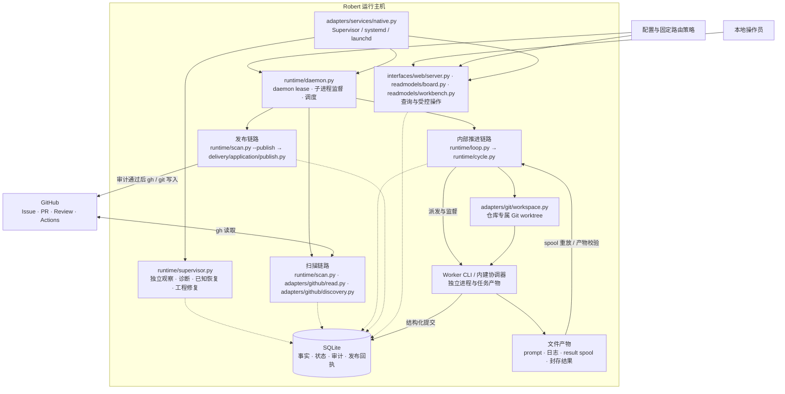

`robert daemon run` 使用三条链路；`robert daemon run --once` 和 `robert run once`
保留同步诊断路径。[轮询机制](features/github-polling.md)说明缓存、API 配额、观察批次和恢复。

Git worktree 负责工作目录与分支隔离。模型 CLI 以 Robert 服务账户的权限直接运行，
worktree 和文件 hash 校验不提供操作系统沙箱。Worker 按协议只提交计划动作，
对 GitHub 的实际写入由审计后的 publisher 执行。

源码：[常驻调度](../src/robert_agent/runtime/daemon.py)（`_background_decision`、`_resident_loop`）、
[控制子进程](../src/robert_agent/runtime/control.py)、[扫描与发布入口](../src/robert_agent/runtime/scan.py)、
[服务生成](../src/robert_agent/adapters/services/native.py)。

## 模块关系

箭头表示主要调用关系，节点按责任分组，不表示全部 Python import。
`runtime/cycle.py` 组合单次运行，`application/repository_cycle.py` 编排每个仓库的用例；
政策、资源和外部动作由各领域模块负责。

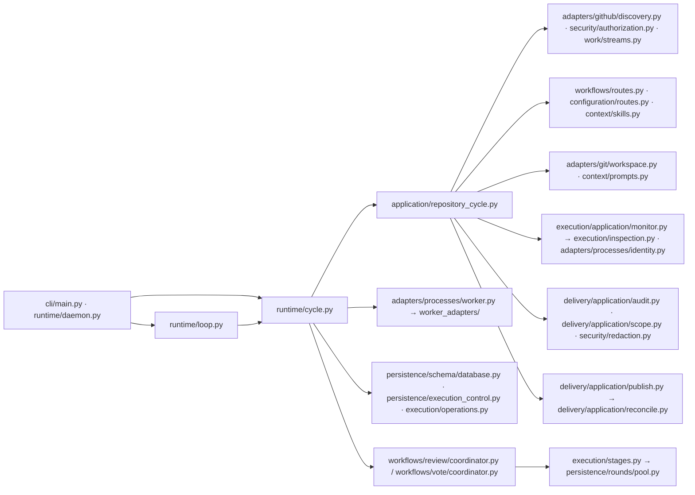

| 责任 | 主要模块 | 关键契约 |
| --- | --- | --- |
| 外部发现 | [runtime/scan.py](../src/robert_agent/runtime/scan.py)、[adapters/github/read.py](../src/robert_agent/adapters/github/read.py)、[adapters/github/discovery.py](../src/robert_agent/adapters/github/discovery.py) | 完整观察批次先落盘；缓存命中仍需本地授权 |
| 授权与协作线程 | [security/authorization.py](../src/robert_agent/security/authorization.py)、[work/streams.py](../src/robert_agent/work/streams.py) | 正文不能扩大权限；Issue 与 PR 保留各自主线 |
| 路由与准备 | [workflows/routes.py](../src/robert_agent/workflows/routes.py)、[configuration/routes.py](../src/robert_agent/configuration/routes.py)、[context/skills.py](../src/robert_agent/context/skills.py)、[adapters/git/workspace.py](../src/robert_agent/adapters/git/workspace.py)、[context/prompts.py](../src/robert_agent/context/prompts.py) | 固定输出、动作权限与 workspace 策略；缺必需 Skill 时不启动 |
| 执行与监督 | [adapters/processes/worker.py](../src/robert_agent/adapters/processes/worker.py)、[worker_adapters/](../src/robert_agent/worker_adapters/)、[execution/inspection.py](../src/robert_agent/execution/inspection.py)、[adapters/processes/identity.py](../src/robert_agent/adapters/processes/identity.py) | 环境白名单、进程身份、心跳、超时与退出证明 |
| Worker 交接 | [worker/](../src/robert_agent/worker/)、[delivery/contract.py](../src/robert_agent/delivery/contract.py)、[execution/spool.py](../src/robert_agent/execution/spool.py) | 绑定任务与 Attempt；规范化计划动作；持久提交与冲突拒绝 |
| 审计与发布 | [delivery/application/audit.py](../src/robert_agent/delivery/application/audit.py)、[delivery/application/scope.py](../src/robert_agent/delivery/application/scope.py)、[security/redaction.py](../src/robert_agent/security/redaction.py)、[delivery/application/publish.py](../src/robert_agent/delivery/application/publish.py)、[delivery/application/reconcile.py](../src/robert_agent/delivery/application/reconcile.py) | 校验证据、权限与文本；发布锁、远端确认、去重与有限重试 |
| 状态与内部调度 | [persistence/schema/database.py](../src/robert_agent/persistence/schema/database.py)、[persistence/execution_control.py](../src/robert_agent/persistence/execution_control.py)、[execution/operations.py](../src/robert_agent/execution/operations.py)、[work/wakeup.py](../src/robert_agent/work/wakeup.py)、[adapters/notifications/wakeup.py](../src/robert_agent/adapters/notifications/wakeup.py) | SQLite 事务与事实回执；通知只是提示；恢复受主体状态约束 |
| 内建多模型流程 | [workflows/review/coordinator.py](../src/robert_agent/workflows/review/coordinator.py)、[workflows/vote/coordinator.py](../src/robert_agent/workflows/vote/coordinator.py)、[execution/stages.py](../src/robert_agent/execution/stages.py)、[persistence/rounds/pool.py](../src/robert_agent/persistence/rounds/pool.py) | 冻结输入、共享额度、封存输出、复用已校验阶段 |
| PR 自修复 | [workflows/pr_health.py](../src/robert_agent/workflows/pr_health.py)、[workflows/pr_remediation.py](../src/robert_agent/workflows/pr_remediation.py) | 仓库显式开启；证据、版本、次数与预算限制 |
| 操作与可观测性 | [interfaces/web/server.py](../src/robert_agent/interfaces/web/server.py)、[work/application/control.py](../src/robert_agent/work/application/control.py)、[readmodels/status.py](../src/robert_agent/readmodels/status.py)、[operations/diagnostics.py](../src/robert_agent/operations/diagnostics.py)、[delivery/application/notifications.py](../src/robert_agent/delivery/application/notifications.py) | 默认只读；写入需身份、CSRF 与状态校验；诊断导出脱敏 |
| 可选知识与查询 | [context/project.py](../src/robert_agent/context/project.py)、[context/knowledge.py](../src/robert_agent/context/knowledge.py)、[integrations/openclaw.py](../src/robert_agent/integrations/openclaw.py) | 项目记忆与运行知识可复用；OpenClaw 提供查询及显式启用的受认证消息入口 |

## 事件授权、串行协作与路由

这是新外部请求的决策图。系统生成的 PR 自修复请求走单独的策略入口。
可信身份使事件可以驱动工作，正文仍作为不可信输入处理。

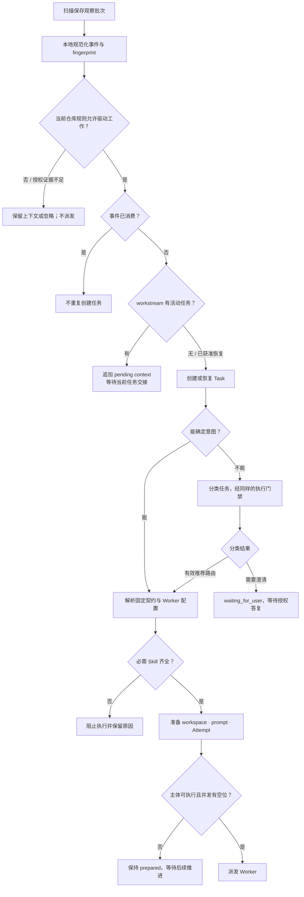

指派事件核对指派者，review request 核对请求者，提及核对 actor；历史参与身份和
仓库角色本身不能启动 Worker。当前任务只消费显式报告已处理的事件身份，剩余事件
继续后续任务。`waiting_for_user` 必须收到授权答复才能恢复。

`route_task` 按来源、意图与已有 PR 选择分析、新 PR、更新 PR、源码评审、评审回复、
投票或分类。配置不能扩大固定路由的 `allowed_github_actions`、`expected_output`、
`verification_policy` 与 workspace 权限。

源码：[authorize_event](../src/robert_agent/security/authorization.py)、[plan_event](../src/robert_agent/work/streams.py)、
[route_task](../src/robert_agent/workflows/routes.py)、[仓库用例编排](../src/robert_agent/application/repository_cycle.py)（`run_repo_pipeline`）、
[事件消费与接续](../src/robert_agent/work/application/completion.py)
（`_mark_consumed_events`、`_create_child_task_for_pending_events`）。
行为见 [test_workstreams.py](../tests/work/test_workstreams.py) 和
[test_discovery.py](../tests/adapters/github/test_discovery.py)。

## Issue 到 PR 的时序

这是 `new-pr` 成功路径。扫描、监督、审计与发布可以分多轮推进；箭头表示消息和
持久交接，不表示所有步骤在同一进程或事务中同步完成。

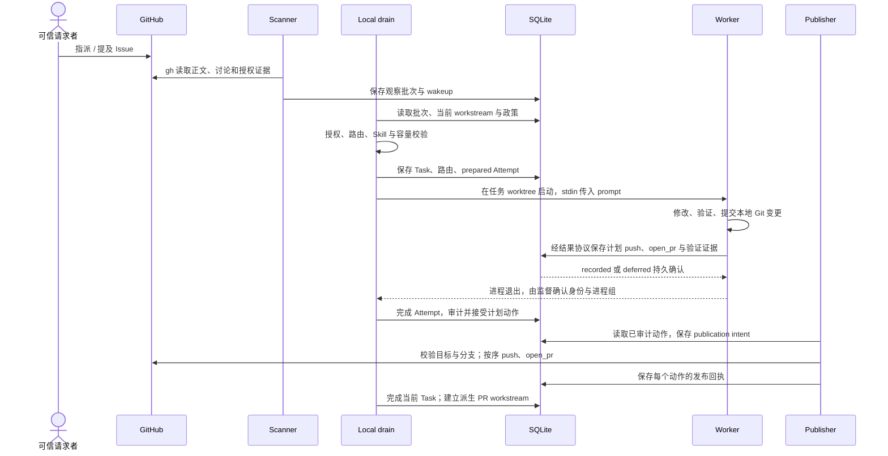

新 PR 先发布分支再创建 PR。派生 PR 记录 origin Issue，评审及后续修改归属
PR workstream。任务执行完成、动作发布成功、远端 PR 合并是三种独立事实。

源码：[工作目录策略](../src/robert_agent/adapters/git/workspace.py)、[启动适配器](../src/robert_agent/adapters/processes/worker.py)、
[结果入口](../src/robert_agent/delivery/application/submission.py)、[结果审计](../src/robert_agent/delivery/application/result_audit.py)（`audit_completed_results`）、
[最终完成与派生 PR](../src/robert_agent/work/application/completion.py)
（`finalize_accepted_result`、`_materialize_open_pr_workstream`）。
看板定义见 [web-lifecycle-board.md](features/web-lifecycle-board.md)。

## 结果提交、唤醒与内部推进

校验、规范化与预审计通过后，spool 原子保存最终提交。数据库事务将 result、
计划动作与 `worker_result_ready` 一起保存，提交后尽力发送 Unix datagram 通知。
通知丢失仍能依靠持久状态检查推进。

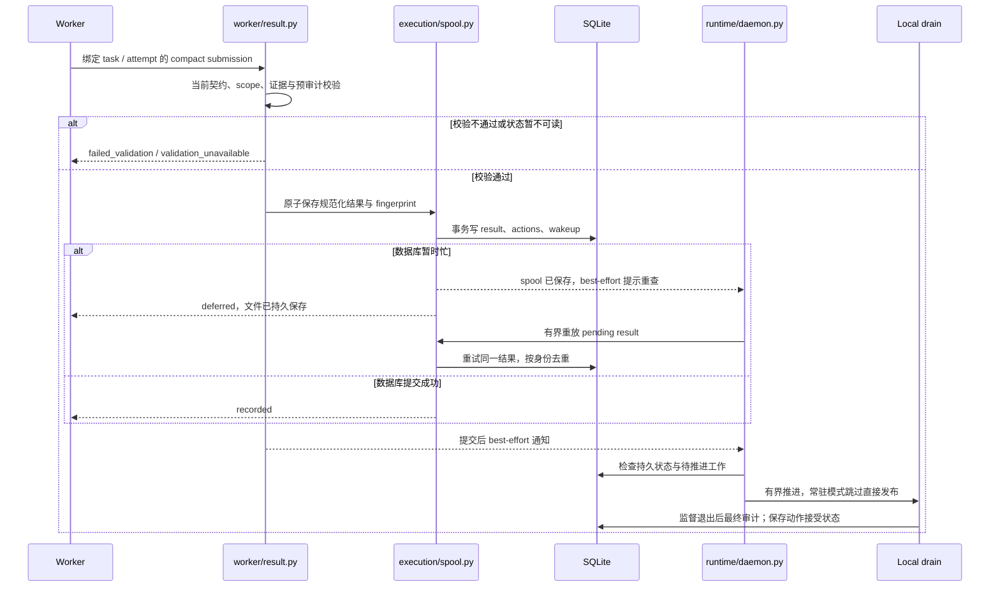

`recorded` / `deferred` 表示持久交接成功，最终审计仍由 Robert 完成。已登记进程
必须确认进程组停止后才进入可发布的完成态。相同最终提交复用原结果，冲突提交拒绝；
迟到结果受当前 Attempt、主体及取消状态约束。

`runtime.loop.run_loop` 限制轮次、总时间、每轮派发数与累计发布数，无进展时停止。
通知只能让 daemon 尽快重查数据库，不能跳过 lease、审计和并发限制。

源码：[record_result 与重放](../src/robert_agent/delivery/application/submission.py)、[原子 spool](../src/robert_agent/execution/spool.py)、
[本地通知](../src/robert_agent/adapters/notifications/wakeup.py)、[有界循环](../src/robert_agent/runtime/loop.py)。
行为见 [test_compact_result.py](../tests/delivery/test_compact_result.py)、
[test_submission.py](../tests/delivery/test_submission.py) 和 [test_wakeup.py](../tests/work/test_wakeup.py)。

## 发布去重与崩溃恢复

publisher 在任务发布锁内核对已审计 scope，记录 intent 与预算，再调用外部命令。
SQLite 写事务不跨越远端副作用。三个远端判定是 `delivery.application.reconcile` 的返回值，
不表示 Task 状态。

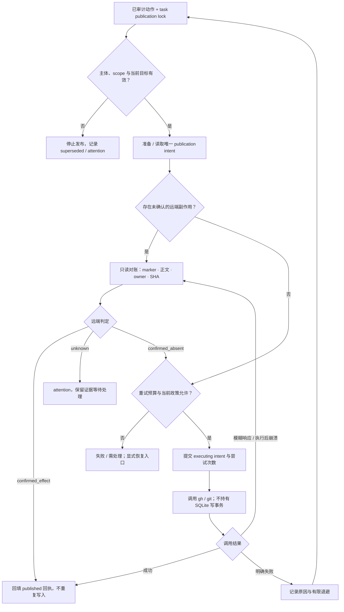

去重不等于网络请求保证恰好一次。`action_id`、`idempotency_key` 与请求 fingerprint
绑定本地 intent；远端 marker、正文、PR owner、分支与 SHA 证明实际效果。
无法证明存在或缺失时进入 `attention`，不能假设写入失败而重复发布。
发布前的远端校验独立于 discovery 缓存。自动重试受次数、时间与退避约束，
人工重试也须重新核对当前权限和版本。

源码：[publish_ready_actions](../src/robert_agent/delivery/application/publish.py)、
[classify_remote_state](../src/robert_agent/delivery/application/reconcile.py)、
[publication intent](../src/robert_agent/delivery/application/intents.py)、[发布锁](../src/robert_agent/delivery/lock.py)、
[execution/retry.py](../src/robert_agent/execution/retry.py)。
崩溃与重复写入行为见 [test_publication_reconcile.py](../tests/delivery/test_publication_reconcile.py)。

## Worker 监督与失败恢复

心跳、结果、进程身份和进程组退出共同决定下一步。图概括普通 Worker 路径，
多模型阶段和控制子进程有各自的身份记录与清理路径。

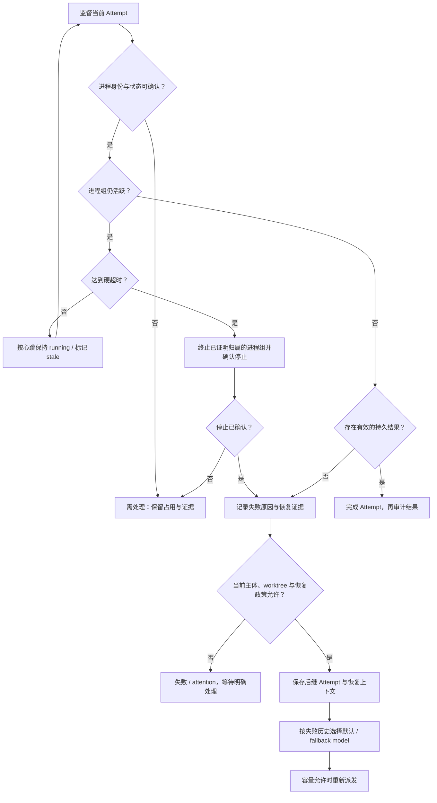

`stale` 不表示进程已退出。结果已收到但退出尚未证明时仍计入并发占用；未知身份、
未知启动和未确认清理不能释放额度或盲目拉起替代进程。普通 Worker 可配置
`fallback_model`：同一 workstream 连续两次 `failed_timeout` 后选择备用模型，
effort 保持不变；恢复路径也可能使用已保存的模型恢复信息。

主体恢复、Worker 重试、发布重试与 PR 自修复 Episode 预算是不同层次。
`execution_subjects` 记录 `active`、`terminal`、`attention` 与主体恢复计数。
取消或失效主体不能靠迟到结果继续发布。

结果兼容性门禁由 `execution.application.cutover` 检查：不支持的结果可按任务隔离，
未知 spool 或读取失败会暂停控制面。隔离不证明进程已停；恢复走显式 retrigger。

源码：[classify_attempt](../src/robert_agent/execution/inspection.py)、[进程身份](../src/robert_agent/adapters/processes/identity.py)、
[监督与恢复](../src/robert_agent/execution/application/monitor.py)
（`supervise_running_attempts`、`recover_failed_timeout_attempts`）、
[派发](../src/robert_agent/execution/application/dispatch.py)、
[主体控制](../src/robert_agent/execution/operations.py)、[结果兼容性门禁](../src/robert_agent/execution/application/cutover.py)。
边界见 [test_agent_lease_safety.py](../tests/execution/test_agent_lease_safety.py) 和
[test_cutover_recovery.py](../tests/execution/test_cutover_recovery.py)。

## 独立任务监督

`runtime/supervisor.py` 是独立于业务 daemon 的服务入口。默认 `observe` 只记录观察与
事件；心跳、进程存活或一次恢复函数返回都不能证明业务已取得进展。

显式 `decide` 模式以 Issue/PR 的根 workstream 聚合关联事实与历史，由模型选择下一步。
CI/冲突消费者和 Worker 恢复消费者先上报候选，再检查 `supervision.decisions` 的精确授权；
执行仍由原领域负责。`supervision/application/decision_loop.py` 调度无工具模型命令，
`adapters/processes/model_command.py` 管理有界输出和进程清理。事件变化和到期复查驱动后续决策。
决策、问题、回复及执行回执保存在命名 supervision checkpoint 中，历史决策单独留档。
`work/questions.py` 记录系统问题；已认证 Reply 更新监督上下文而不创建新执行。

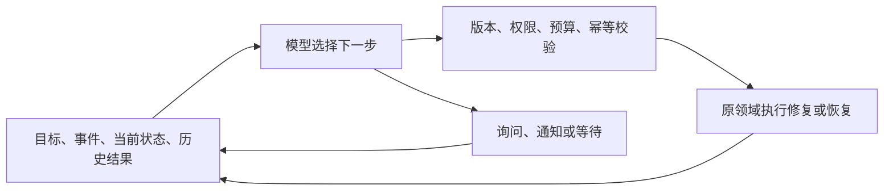

`observe` / `recover_known` 保持原模式；以下图描述它们的观察、诊断与已知恢复流程。

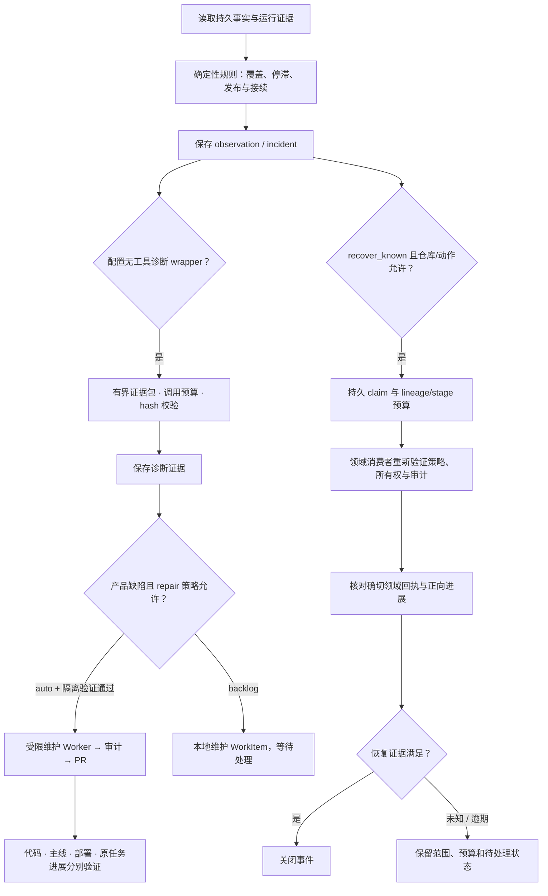

已知恢复消费者不扩大原有重试权限，未确认的远端效果必须先对账。自动工程修复需要
显式命令 Worker、受信 launcher 和实际隔离验证；普通模型 CLI 的 worktree 隔离不满足
该条件。PR 合并、部署匹配和原任务进展分别留证。

源码：[观察用例](../src/robert_agent/supervision/application/observation.py)、
[规则](../src/robert_agent/supervision/rules.py)、[恢复事实](../src/robert_agent/supervision/store.py)、
[维护工作流](../src/robert_agent/workflows/maintenance/repair.py)。
配置、命令与限制见 [持续任务监督](features/task-supervision.md)。

## 多模型评审与投票

两种内建协调器共用 `StageCoordinator` 和 SQLite 模型进程池。一轮占一个任务并发槽，
各阶段模型再申请共享额度。图用两个模型说明阶段顺序，实际数量来自配置。

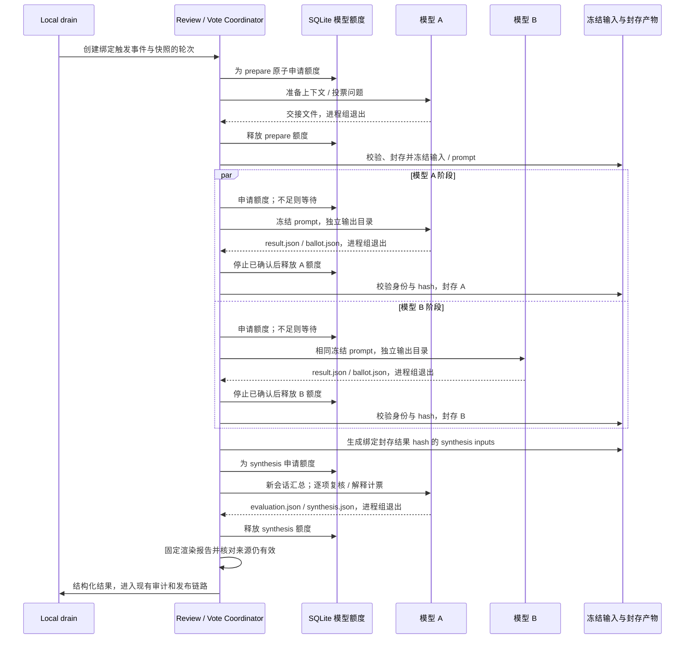

| 机制 | 多模型评审 | 多 Agent 投票 |
| --- | --- | --- |
| 开启条件 | `review-pr` 显式启用且 PR 作者命中 allowlist | 配置启用、来源与投票意图满足路由 |
| 冻结输入 | 当前 head/base、完整 PR diff、源码索引、上下文与 prompt | 当前来源、投票问题、选项与规则；需要时准备源码 |
| 并行输出 | findings、证据与覆盖范围 | 结构化 ballot；`workflows/vote/tally.py` 确定性计票 |
| 汇总 | 逐项评估来源 finding，不用多数票认定缺陷 | 读取 tally，生成解释与分歧报告 |
| 发布 | 绑定 PR head 的 Review `COMMENT` | Issue / PR 评论 |

投票准备不充分时可请求澄清；只失败一个模型时可复用其他已验证成功的阶段结果。
`review_runs` / `vote_runs` 的 `slot_reserved` 计算共享占用；等待额度不计入单个
Worker 的运行超时，父任务期限仍有效。未知启动保留额度。封存是应用层交接校验，
同账户进程仍可能访问其他目录。

源码：[workflows/review/coordinator.py](../src/robert_agent/workflows/review/coordinator.py)、
[workflows/vote/coordinator.py](../src/robert_agent/workflows/vote/coordinator.py)、[StageCoordinator](../src/robert_agent/execution/stages.py)、
[persistence/rounds/pool.py](../src/robert_agent/persistence/rounds/pool.py)、[workflows/vote/tally.py](../src/robert_agent/workflows/vote/tally.py)。
配置与恢复见 [multi-model-review.md](features/multi-model-review.md) 和 [multi-agent-vote.md](features/multi-agent-vote.md)。

## Agent 输入生成

[`context.prompts`](../src/robert_agent/context/prompts.py) 统一生成普通 Worker、原生
review/vote、监督和受限维护的阶段指令。调用方提供结构化事实，公共原则、阶段要求和
交付协议来自 [`resources/prompts/`](../src/robert_agent/resources/prompts/)。
[`prompt_contract`](../src/robert_agent/context/prompt_contract.py) 定义输入和输出值；
[`prompt_profiles`](../src/robert_agent/context/prompt_profiles.py) 限定阶段及适用组合。

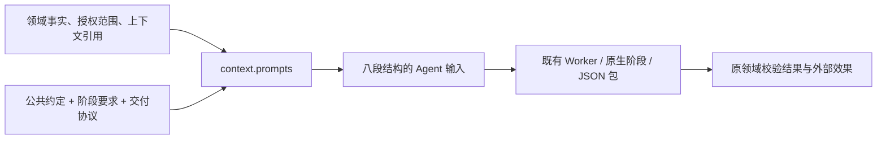

阶段选择和权限仍由流程 owner 决定；context 不导入具体 workflow 或监督执行用例。
helper、原子文件、stdout JSON 保持各自结果格式和完成条件。阶段、上下文和恢复
边界见 [Agent 输入与阶段契约](features/agent-prompts.md)。

## PR 自修复

CI 和冲突修复默认关闭，按仓库 `pr_automation` 显式开启；CI 还要求非空
`check_allowlist`。Episode 将系统请求限制在当前 PR 的版本、次数和预算内。

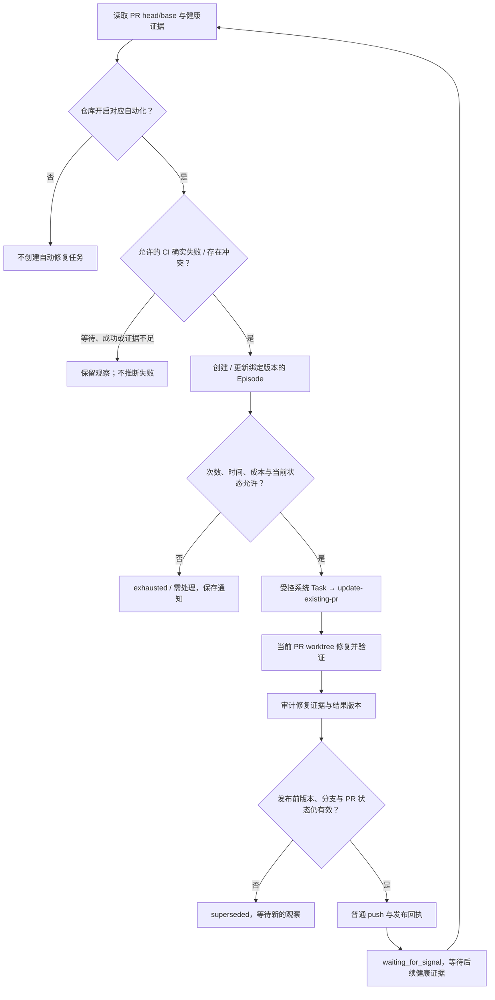

push 成功不等于 CI 转绿。后续观察确认修复结果、继续等待或创建下一次有限尝试。
CI 等待、未知 mergeability、不可读取日志与真实失败保持区分；版本变化使旧证据失效。
Episode 的 `resolved`、`exhausted`、`superseded` 与 `canceled` 记录不同终结原因。

源码：[workflows/pr_health.py](../src/robert_agent/workflows/pr_health.py)、[Episode 与预算](../src/robert_agent/workflows/pr_remediation.py)
（`upsert_health_episodes`、`budget_status`、`next_system_decisions`）、
[修复发布校验](../src/robert_agent/delivery/application/publish.py)。行为见 [test_pr_health.py](../tests/workflows/test_pr_health.py)
和 [test_pr_remediation_integration.py](../tests/integration/test_pr_remediation_integration.py)。

## 核心数据关系

这是概念关系图，省略物理字段。实线是主要归属，虚线是关联或投影；并非每条边
都有 SQL 外键。`execution_subjects` 按主体类型与 ID 关联 Task 或 Episode。

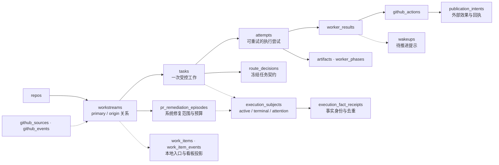

workstream 保留多轮 Task 历史，活动任务由部分唯一索引串行约束。Task 可有多个
Attempt，最终结果与已绑定的 Attempt 交接，发布动作归属 result。
本地和 GitHub 任务进入同一控制面，`work_items` 提供生命周期投影与操作入口。

专用表保留各自边界：`github_scan_batches` / `github_scan_reads` 保存扫描重放输入；
`leases` / `github_control_children` 保存执行所有权；`review_sessions` / `review_runs`
和 `vote_sessions` / `vote_runs` 保存内建轮次；`execution_subjects` 是执行控制的唯一数据源；`execution_fact_receipts` 保存事实去重证据。
`supervision_checkpoints`、`supervision_incidents`、`supervision_recovery_actions`
保存独立监督的观察、事件和恢复记录。

源码：[主 schema](../src/robert_agent/resources/db/schema.sql)、[存储初始化](../src/robert_agent/persistence/schema/database.py)、
[执行主体与事实回执](../src/robert_agent/persistence/execution_control.py)、[persistence/rounds/review.py](../src/robert_agent/persistence/rounds/review.py)、
[persistence/rounds/vote.py](../src/robert_agent/persistence/rounds/vote.py)。基础概念见 [concepts.md](concepts.md)，
配置见 [reference.md](reference.md)。

## 维护图示

改变机制时，同时核对对应源码入口、schema 与行为测试，再更新节点和分支。
架构图表达责任与信任边界，时序图表达持久化与外部效果的先后，流程图保留失败、
等待和未知状态。规划目标、mock 验证或 Worker 声明不能替代当前实现证据。

## 操作员消息边界

[双向消息方案](features/operator-messaging.md)复用工作项事件、通知 outbox 和现有操作命令。
`work/messaging.py` 维护问题关联规则，`delivery/messages.py` 构建脱敏信封，
`adapters/notifications/messaging.py` 发送消息。`work/application/messaging.py`
校验发送者、会话和仓库授权后调用既有命令；OpenClaw 插件只做协议转换。
持久化统一调用 `persistence/queries/notifications.py`、`persistence/queries/work_item_events.py`
和 `persistence/stores/notifications.py`；问题和通知使用调用方事务原子提交，
收件箱、发送队列和就绪检测在限额前应用相同的未解决问题和仓库筛选。
通知确认不会改变 Supervisor 事件或执行所有权。未来渠道复用同一版本化协议。
