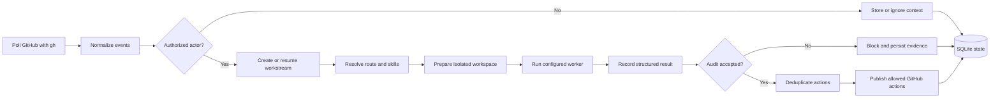

# Robert Concepts

[文档目录](README.md)

## In plain language

| Term | Meaning |
| --- | --- |
| Worker | The local coding-agent command Robert invokes. |
| Route | The kind of work requested and what output/actions it permits. |
| Workstream | The ongoing conversation for one issue, PR, or local work item. |
| Task / attempt | One unit of requested work / one execution try for it. |
| Audit / publication | Checking proposed results / carrying out allowed GitHub actions. |
| Daemon / Web | The background executor / the board that displays and controls work. |

For a concrete example, follow the [first-task walkthrough (中文)](first-task.md).

## Architecture

Robert is a local Python control plane with five boundaries:

1. discovery and authorization through the authenticated `gh` CLI;
2. routing and immutable workspace policy;
3. worker dispatch inside repository-specific Git worktrees;
4. result audit, redaction, and publication deduplication;
5. durable SQLite state under `~/.local/share/robert/`.

The installed `robert` command reads `~/.config/robert/config.yml`.
`runtime.cycle` composes bounded cycles, `runtime.daemon` schedules them,
`persistence.schema` owns schema setup, and route, worktree, dispatch,
audit, and publication modules enforce separate policies.

Robert uses polling. It does not include a webhook receiver
or GitHub App authentication.

The [architecture and mechanism diagrams (Chinese)](architecture.md) trace the
current modules, resident daemon lanes, worker handoffs, recovery, and publication.

## Workflow



A cycle validates configuration, acquires repository leases, supervises active
attempts, processes events, prepares tasks, dispatches workers, audits results,
publishes allowed actions, and records a summary.

## Trust Model

GitHub content is untrusted even when syntactically valid. Robert creates work
only for configured repositories and authorized actors.

Each repository defines `trusted_actors`. Events from other users may be
retained as context, but they cannot independently start protected work. The
authenticated `gh` CLI session is the only GitHub credential source; tokens
must not be stored in configuration.

The worker protocol prohibits direct publication. Workers record structured
planned actions; their OS account permissions are not restricted by Git worktrees.
Robert checks route permissions, verification evidence, skill evidence,
idempotency markers, and redaction before publication.

Direct `robert web run` is read-only on `127.0.0.1:8765` by default. Writable
mode uses an operator identity and CSRF token. Remote binding requires explicit
acknowledgement and an authenticated reverse proxy. Service templates can pass
different flags; inspect the [Supervisor setup](guides.md#daemon-service).

The [lifecycle board](web-lifecycle-board.md) projects durable tasks, attempts,
phases, heartbeats, and publication receipts. Writable controls submit guarded
requests; the daemon must be running to schedule work. Historical worker
completion, successful publication, and observed PR merge are separate facts.

## Workstreams

A workstream is the durable collaboration thread for one GitHub issue, pull
request, or local work item. It links sources, events, tasks, attempts,
artifacts, worker results, and publication actions.

Issue and pull-request mainlines remain separate. A Robert-created pull request
records its origin issue, while review follow-up stays on the pull-request
workstream and reuses its branch.

Only one active task owns a workstream at a time. Additional authorized events
become pending context. Waiting-for-user tasks resume only after an authorized
reply.

```bash
robert status --config ~/.config/robert/config.yml
robert task show TASK_ID --config ~/.config/robert/config.yml --output json
```

## Routes

Routes define expected worker output, allowed GitHub actions, verification
policy, workspace mode, worker selection, and skill guidance.

The [packaged route catalog](../src/robert_agent/resources/routes.yml) contains
`comment-analysis`, `new-pr`, `update-existing-pr`, `review-pr`, `review-comment`,
`classification-result`, `local-result`, `waiting-for-user`, and `vote`.

Immutable fields such as `allowed_github_actions`, `expected_output`,
`verification_policy`, and `workspace_mode` cannot be changed in
`~/.config/robert/config.yml`. Global and repository overrides select workers,
ordinary model/effort, required/recommended skills, and supported native
review/vote settings. For example:

```yaml
routes:
  new-pr:
    worker: coder
    model: default
    effort: default
    required_skills: []
    recommended_skills: []
```

Worker names must exist in `workers`. Repository overrides replace only the
fields they explicitly provide; skill lists replace inherited lists, and native
review/vote settings replace the whole block. See [configuration](reference.md#configuration).

## Worker Contract

Robert sends a task prompt to a configured local worker through standard input.
The prompt names the task, attempt, workstream, route, allowed GitHub actions,
workspace, verification policy, skill guidance, and registered context files.

The worker records a structured result with:

- task and attempt identifiers;
- expected output type;
- planned GitHub actions;
- consumed event fingerprints;
- skills actually used;
- verification evidence;
- optional memory and review-point evaluation.

Workers must not publish GitHub changes directly. Robert audits and publishes
accepted actions. The environment contains only standard variables plus names
listed in the worker's `environment_allowlist`.

Worker state and artifacts live under `~/.local/share/robert/`; configuration
lives at `~/.config/robert/config.yml`.
