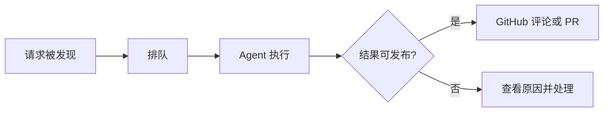

# 完成第一个任务

[文档目录](README.md) · [安装指南](human-install.md) · [故障排查](troubleshooting.md)

目标是确认“GitHub 请求 → 本地 Agent → GitHub 结果”这条链路确实可用。
先选择一个你允许 Robert 发布评论的测试仓库；下面的评论由你主动发送，会触发真实模型调用和 GitHub 写入。

## 开始前

- daemon 与 Web 已启动，使用同一配置和数据目录。
- 仓库在 `repos` 中，默认分支、`upstream` 与 `origin` 已核对。
- `github.account` 是机器人账号，发评论的人在该仓库的 `trusted_actors` 中。
- **用可信的人类账号发请求，不要用机器人账号给自己派活。** 机器人自己的提及评论只作上下文，不触发这类任务。
- 本地 Agent 已完成登录，有可用的模型配额；代码仓库的构建和测试工具另行安装。

## 1. 先让它分析，不改代码

在该仓库创建或选择一个普通 Issue，用可信账号评论。将 `@robert-bot` 换成实际监听账号：

```text
@robert-bot 请说明这个仓库的主要入口和测试运行方式。
只分析并回复评论，不修改代码，不创建 PR。
```

请求应出现在正文中，不要放在引用或代码块内。陈述明确任务，比单独提及账号更容易得到预期结果。
可在已有 Issue/PR 的评论中提及，也可通过受支持的指派或 PR 评审请求触发；首次验证优先用明确提及。

Robert 使用轮询。默认启动不会立即扫描，初始等待通常由 `github.polling.fallback_seconds`
控制（默认 300 秒）；后续扫描间隔受 GitHub 响应和配额影响。
不要因为几秒内没有回复就重复评论或重启服务，先看 `/operations` 的扫描记录。

## 2. 到看板核对进度

打开 `http://127.0.0.1:8765/`，按仓库和来源 Issue 找到任务，打开详情。



这是一条简化路径；完整状态见[生命周期看板](features/web-lifecycle-board.md)。
需要命令行检查时：

```bash
robert status --config ~/.config/robert/config.yml --output json
robert task show TASK_ID --config ~/.config/robert/config.yml --output json
```

将 `TASK_ID` 换成看板或状态输出中的真实任务 ID。完成一次分析任务应能看到：

1. 来源与这条请求一致的任务和执行记录。
2. Agent 的结果、审核/发布状态；有错误时保留可解释原因。
3. GitHub Issue 中实际出现对应回复，且内容符合“只分析”的要求。

只有模型日志显示“完成”，还不能证明回复已发布。以任务发布记录和实际 GitHub 评论共同确认。

## 3. 再验证代码与 PR（可选）

前一步成功后，选择小而明确、具有可运行验证方式的改动。你可以在测试仓库的新 Issue 中写：

```text
@robert-bot 请修正 README 中这条失效链接：旧地址是……，正确地址是……。
只修改这一处，检查链接并提交 PR；不要合并。
```

如果测试的是代码修改，提供预期行为和测试要求。目标仓库若有 `AGENTS.md`，
应说明开发环境、测试命令及交付约束；Robert 自身的安装不会替业务项目准备依赖。

预期结果：Robert 创建工作区，Agent 保存修改和验证证据，审计通过后推送分支并创建 PR。
在 GitHub 核对 diff、验证记录与 PR 来源，再决定如何评审和合并。
PR 创建失败可能是 Git 写权限问题，即使分析评论成功也不能证明 push 可用。

要继续修改，在对应 PR 中用可信账号评论：

```text
@robert-bot 请根据这条评审意见修改，运行相关检查并更新当前 PR。
```

同一 Issue/PR 的后续请求会关联到其持续协作记录（workstream），同一记录内串行处理。
Issue 和其创建的 PR 是相互关联、但不同的协作记录；PR 修改应放在 PR 中。

## 4. 有问题时怎么处理

| 看到的情况 | 下一步 |
| --- | --- |
| 没有任务 | 查扫描记录、仓库配置、提及账号和评论者的可信身份 |
| 一直排队 | 确认 daemon 运行、容量是否占满、同一协作记录是否仍有任务 |
| 等待你的回复 | 阅读提问，在对应来源以可信账号回复，或使用已启用的看板写入功能 |
| 执行失败 | 先检查模型认证、配额、仓库依赖、权限和失败日志，再重试 |
| 发布失败 | 检查发布记录及远端是否已产生结果，再使用允许的发布恢复入口 |
| 待评审 | 打开 PR 检查结果；待评审不等于已合并 |

不要为重试删除 SQLite、绕过审计或手工清理未知进程的锁。
详细排查见[故障排查](troubleshooting.md)。

## 接下来

先保持单仓库、单 Worker 运行，再按需要增加[其他 Worker 或多仓库](guides.md)、
[多模型评审](features/multi-model-review.md)、[持续监督](features/task-supervision.md)和[消息通知](features/operator-messaging.md)。
