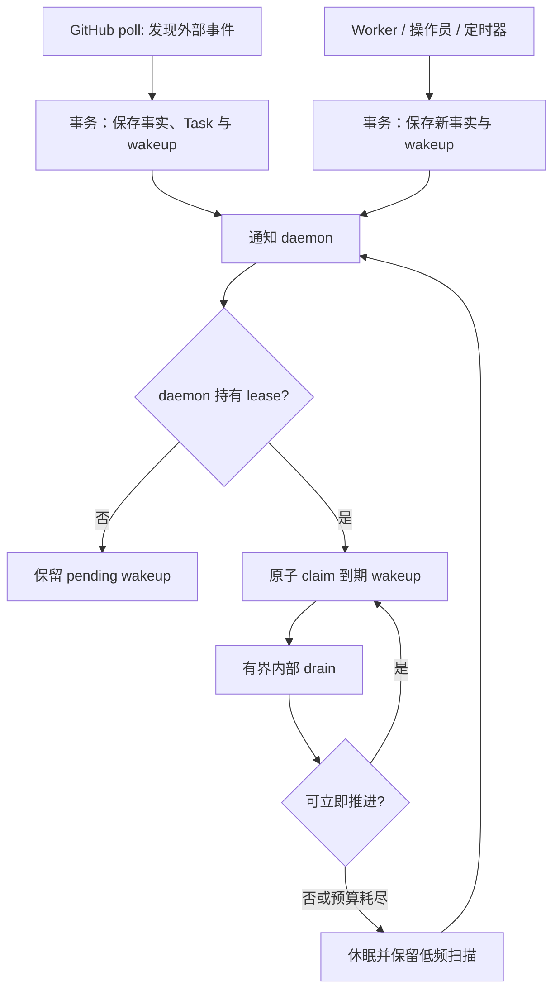

# Robert 内部事件驱动 Drain 设计

## 摘要

Robert 当前通过定期拉取 GitHub 通知发现外部事件，并将任务、Attempt、Worker
结果和 wakeup 持久化到 SQLite。这个模型在可靠性上是合理的，但内部状态推进仍
会受常驻 daemon 的本地轮询节奏影响：Worker 写入结果后，daemon 可能正在休眠，
需要等待下一次检查才会审计、发布或安排后续工作。

本设计将两类循环分开：

- **外部轮询**：有频率、配额与退避控制地发现 GitHub 新事实。
- **内部 drain**：由持久化的本地 wakeup 驱动，在不访问 GitHub 通知接口的前提
  下，有界地推进已知工作直到稳定。

信号只负责降低延迟；SQLite 中的 pending wakeup 仍是唯一可靠的队列和恢复来源。

## 背景与现状

当前主链路已经具备以下行为：

1. daemon 的 live poll 调用一次 `run_once` 拉取和处理 GitHub 事件。
2. 事件被授权、路由后，Task 与 prepared Attempt 被保存到 SQLite。
3. live poll 后 daemon 会执行 `local_drain`，它通过 loop engine 重复调用本地
   `run_once`，从而派发可执行 Worker。
4. Worker 完成后通过结构化结果协议写入 `worker_results`，并在同一数据库事务中
   创建 `worker_result_ready` wakeup。
5. 已经休眠的 daemon 不会因该数据库写入被主动唤醒；它需要在下一次本地检查时
   发现 pending wakeup，才能继续 audit、publish 或安排后续 Task。

因此，事件发现后的第一段链路通常已经会立即推进；主要延迟位于运行中的 Worker、
操作员审批或其他本地事实写入之后。

## 目标

1. GitHub 已发现事件产生的后继状态，不等待下一次 GitHub notification poll。
2. Worker result、操作员决定、定时到期和恢复请求能够低延迟唤醒 daemon。
3. 通知丢失、daemon 重启或重复通知时，不丢工作、不重复发布、不绕过审计。
4. 内部推进不扩大 GitHub API 调用，也不绕过现有 lease、并发、路由和发布边界。
5. 单个高活跃 workstream 不得无限占用 daemon，其他仓库和任务仍具备公平性。

## 非目标

- 不替换 GitHub polling 为 GitHub App、Webhook 或外部消息队列。
- 不让 Worker 直接调用 audit、publish 或下一阶段业务逻辑。
- 不把所有状态迁移都改成同步递归调用。
- 不取消低频数据库扫描这一恢复兜底。
- 不在本设计中引入需求规划或产品生命周期阶段。

## 核心原则

### 外部发现与内部推进分离

GitHub poll 的职责仅是发现和验证外部事实。它受 API 配额、速率限制和退避策略
约束。内部 drain 的输入是已经写入 SQLite 的 Task、Attempt、Worker result、
wakeup 与操作员事件；默认不得重新调用 GitHub 通知接口。

发布前如确实需要确认远端状态，应建模为一个明确、可预算、可审计的远端校验节点，
而不是在内部 drain 中隐式执行新的通知拉取。

### SQLite 是可靠队列，信号只是提示

每一个能推进内部状态的事实，都必须先在同一事务中持久化其 wakeup。进程内条件
信号、Unix domain socket 或其他本地通知只表达“数据库可能有新工作”；它们丢失
时不能影响正确性。

daemon 启动时、低频兜底检查时和收到信号时，都调用同一个“claim 并 drain”入口。
不得存在只由信号触发、却不经 SQLite 证据验证的快捷路径。

### 唯一推进者

持有 daemon lease 的控制面是唯一可以推进状态机的人。Worker、Web UI、命令行
和外部发现器只能写入事实与 wakeup：

- Worker：写结构化 result、artifact 和 `worker_result_ready`。
- Web UI：写经授权的 operator event 和对应 wakeup。
- 定时器：写到期或恢复 wakeup。
- daemon：claim wakeup，按策略改变 Task、Attempt、action 的生命周期。

这避免 Worker result 与 operator cancel、两个 daemon 实例或重复通知并发推进同一
Task。

### 有界地推进到稳定

内部 drain 不应对每个 wakeup 只运行一个步骤后休眠，也不应无限执行。一次 drain
在满足以下任意条件时停止：

1. 当前作用域没有到期 pending wakeup，也没有可审计结果或可派发 Attempt。
2. 达到本轮时间、派发、发布动作、恢复次数或成本/用量预算。
3. 所有可运行工作都被并发上限、人工关口或明确的延迟时间阻塞。
4. 检测到无进展；控制面记录原因并交还调度器。

“稳定”指没有可以安全立即推进的本地工作，不等于所有 Worker 已完成。

## 目标流程

## 状态与数据契约

### Wakeup

保留现有 `wakeups` 表作为 durable outbox。每条 wakeup 至少表达：

- `reason`：例如 `worker_result_ready`、`operator_decision_ready`、
  `attempt_recovery_due`、`publication_retry_due`。
- 关联的 repo、work item、task、attempt 或 result。
- 幂等 `dedupe_key`。
- `not_before_at`、过期时间与状态。
- 生产该 wakeup 的来源运行或事件标识。

新设计不要求 wakeup 自身携带完整业务 payload；消费者必须从关联的持久化事实
重新读取并校验当前状态。这样迟到、重复或乱序 wakeup 都只是可安全忽略的提示。

### Claim

消费前必须原子 claim wakeup，且 claim 必须绑定 daemon run 或 lease owner。一个
wakeup 只能被一个 active drain 消费；崩溃后未完成 claim 通过租约过期或显式恢复
重新变为可消费。

`consumed` 不应表示“已看见”，而应表示其关联状态已经被成功推进、明确阻塞或确认
无需处理。消费失败时保留失败原因和有限重试信息。

### 调度键与公平性

内部队列按 repo 和 workstream 分桶。选择下一项工作时应至少保证：

- 同一 workstream 仍只能有一个 active Task。
- 达到仓库并发上限时不再派发新 Worker。
- 每轮 drain 对单仓库与全局都有时间/动作预算。
- 高优先级任务可以优先，但不能让其他长期等待的可运行任务永久饥饿。

## 关键时序

### 新 GitHub 事件

1. live poll 发现、规范化并授权事件。
2. 控制面在数据库中创建或更新 workstream、Task 与 wakeup。
3. 当前 daemon 不必等待下一次 GitHub poll，直接进入内部 drain。
4. internal drain 路由、准备 workspace、创建 Attempt 并在容量允许时派发 Worker。
5. Worker 运行期间，内部 drain 可因无可推进工作而停止；外部 poll 仍按自己的
   限速独立运行。

### Worker 完成

1. Worker 在同一事务中写 result、planned action 与 `worker_result_ready` wakeup。
2. 成功提交后发出本地通知。
3. 持有 lease 的 daemon 被唤醒，claim wakeup，重新加载 result 与当前 action
   scope。
4. daemon audit result，执行受控 publish，或将 Task 转入 `waiting_for_user`、
   recoverable failure 或 terminal failure。
5. 所有状态迁移仍通过现有 audit、redaction、idempotency 和 publish 边界。

### 通知丢失或 daemon 重启

1. Worker 已提交数据库事务，但本地通知未送达，或 daemon 当时不在运行。
2. pending wakeup 仍保存在 SQLite。
3. daemon 启动和低频扫描检查到 pending wakeup，并走同一 claim/drain 路径。
4. 幂等键与当前状态校验确保重复通知不会导致重复 audit、dispatch 或 publish。

## 本地通知机制选择

第一阶段不需要引入外部消息队列。因为 producer 与 consumer 位于同一主机，建议
抽象一个小的 `wakeup_notifier` 接口，提供以下语义：

- `notify()` 尽力发送、允许失败；调用者不得把失败视为数据库事务失败。
- daemon 在收到通知后只触发一次 drain 请求，不携带业务决策。
- drain 正在运行时，多个通知应合并为“再次检查数据库”，而不是递归启动多个
  drain。
- daemon 不可用时，通知无副作用；后续扫描负责恢复。

可选实现由简到繁：

1. 同一进程内的条件变量或 event：适合 producer 均在 daemon 进程内的场景。
2. Unix domain socket：适合 Worker 作为独立子进程写数据库后通知常驻 daemon，
   且无需引入网络服务。
3. 外部队列：只在跨主机、多控制面实例或需要跨系统事件消费时评估。

当前 Robert 的本地、自托管和单 daemon 定位下，Unix domain socket 加数据库
兜底是最小且足够的方向；实现前应先验证 macOS 与 Linux service 环境下 socket
路径、权限和重启清理策略。

## 失败与边界处理

| 场景 | 正确行为 |
| --- | --- |
| 重复通知 | 重新检查 durable state；若已消费或已终态则无副作用 |
| 通知丢失 | 下次低频扫描消费 pending wakeup |
| daemon 崩溃 | lease 过期后新 daemon 接管；未完成 claim 可恢复 |
| Worker 写入迟到 result | 根据 Attempt 当前状态审计；取消或被替代的 Attempt 不可推进或发布 |
| 内部 drain 无进展 | 记录原因、停止本轮，按本地 poll 间隔兜底重试 |
| 外部 API 限流 | 仅阻止新的外部 poll；不阻止不需要外部读取的内部 drain |
| 发布前远端状态不确定 | 创建明确的远端校验节点，受独立预算与审计控制 |
| 容量已满 | 保留 pending work；Worker 结束或容量释放时发 wakeup |

## 验收标准

1. 一个已经完成路由的本地 Task，在容量可用时无需等待 GitHub poll 即可被派发。
2. Worker 成功写 result 后，活跃 daemon 在通知可用时立即开始 audit；通知不可用时
   仍会在低频扫描中完成 audit。
3. 重复发送同一通知，不会导致重复 Worker dispatch、重复 GitHub action 或重复
   终态迁移。
4. daemon 在 result 写入与通知处理之间崩溃，重启后仍能恰好一次地处理该 result。
5. GitHub rate-limit guard 阻止 live poll 时，本地已有的可审计 result 与可派发
   Attempt 仍可在权限和预算允许时推进。
6. 单一仓库或 workstream 的连续 wakeup 不会饿死其他可运行仓库；测试应证明
   drain 的预算和选择策略生效。
7. Worker、Web UI 或任意外部 producer 不能绕开 daemon lease 直接调用 publish
   或改变受保护的 Task 生命周期。
8. 所有上述情形都有 fixture-backed 集成测试，并同时断言 SQLite 状态、进程行为和
   外部动作去重。

## 待实现前确认的决策

1. daemon 是否始终以单常驻实例运行，还是未来支持多实例接管；这决定 claim/lease
   的详细协议。
2. 本地通知第一阶段是否限定为 Unix domain socket；如是，socket 的生命周期和
   权限由哪个服务组件负责。
3. 内部 drain 的默认全局、仓库和 workstream 时间/动作预算是多少，以及高优先级
   任务的公平性规则。
4. 哪些远端状态确认可以延后到下一次 external poll，哪些发布操作必须同步做
   精确远端校验。
5. `wakeup` 的 claim 状态是否需要扩展为显式的 `claimed`，并记录 claim lease；
   这是实现可恢复消费的关键数据模型决策。

## 建议实施顺序

1. 为现有 wakeup 消费路径补充事件到审计的延迟、重复消费和重启恢复测试，先量化
   基线。
2. 定义原子 claim 与 lease 语义，保证单一推进者。
3. 抽象 best-effort notifier，并让 daemon 收到通知后调度同一条 local drain。
4. 将 internal drain 明确设为不访问 GitHub notification discovery 的本地路径。
5. 加入每 repo/workstream 的 drain 预算和公平性测试。
6. 以故障注入验证通知丢失、重复、daemon 重启和并发接管。

在第 1 至第 4 步完成前，不建议引入新的通用 Graph engine 或外部消息队列；现有
SQLite 状态与 daemon lease 已足以构成正确性基础，优先补齐低延迟唤醒和可恢复
消费即可。
