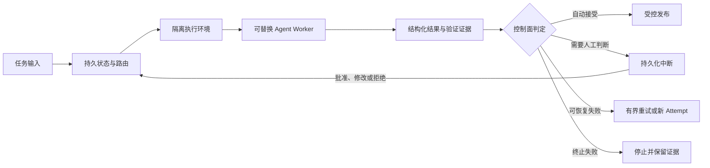
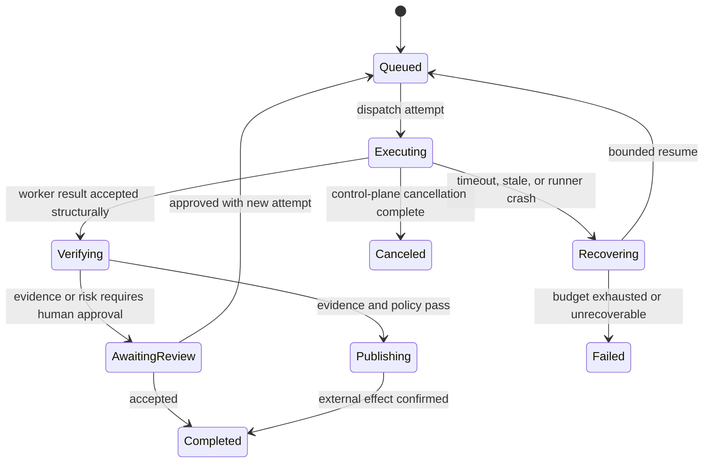

# Agent Harness 可靠性：业界实践与 Robert 验收标准

## 摘要

Robert 应继续演进为一个模型无关的控制面，而不是一组提示词或一个由 Markdown
驱动的流程。可靠的 Agent 系统应将模型相关的推理留在可替换的 Worker 内部，
而由控制面负责持久化状态、权限、预算、验证、恢复与发布。

对 Robert 的第一轮对照结论是积极的：持久状态、隔离工作区、Worker 适配器、
动作审计和发布去重已经具备。成熟度的主要缺口是：经确认的进程组终止、
检查点级别的重放，以及由控制面独立复验的验证证据。

## 业界概念框架

Agent 系统相关术语经常被当作相互竞争的产品来讨论，实际上它们描述的是不同
层级，可以组合使用。

| 概念 | 主要解决的问题 | 单独不能提供的能力 |
| --- | --- | --- |
| 提示词工程 | 向模型说明任务意图、上下文和约束 | 可靠执行、恢复、授权或验收 |
| Agent 循环 | 在单个任务中反复观察、行动、验证和修复 | 跨任务状态、有界恢复或持久审批 |
| 图或工作流引擎 | 显式描述状态、迁移、分支、暂停和恢复 | 正确实现或可信验证 |
| Harness 工程 | 将上下文、工具、环境、反馈、状态和策略组合为可靠系统 | 单一规定的框架或模型 |

图或状态机对 Robert 有价值，因为它能让生命周期迁移可观测、可恢复；但它应管理
工作，而不应规定 Agent 的内部思考。Worker 可以自由使用自己的提示词、循环、
工具和任务拆分策略，只要返回标准的 Robert 协议结果。

## 可靠工作流最重要的八件事

1. **持久状态是事实来源。** 任务、Attempt、审批和外部动作在进程重启后仍然
   存在；聊天历史不能成为唯一恢复机制。
2. **节点足够小且可重放。** 每个控制面节点只承担一项职责，并有已记录的完成
   边界，故障后不会重复已经成功的工作。
3. **副作用具备幂等性。** 创建分支、评论、推送、通知和发布都使用持久键及
   确认记录。
4. **失败需要分类。** 临时基础设施失败有界重试；Agent 可修复失败带证据恢复；
   人工决策暂停；未知失败停止并保留诊断信息。
5. **人工评审是持久化中断。** 批准、修改和拒绝都是明确的状态迁移，能够安全地
   恢复已暂停工作流。
6. **Worker 可替换，协议不可替换。** 任意模型或 Coding Agent 都接收有范围的
   上下文，并在相同策略下返回结构化结果、验证和下一步信息。
7. **验证优先于叙述。** 可执行检查、架构规则、测试和可复验证据决定结果能否
   通过。
8. **预算和取消由控制面强制执行。** 时间、成本、重试和进程终止是硬限制，
   不是写在提示词里的要求。

Markdown 仍适合保存理由、设计决策和导航信息。但不同模型可能有不同解释，且
“文档完成”无法机械验证，因此它不应成为主要的可靠性约束。

## Robert 第一轮对照

| 关键能力 | Robert 当前证据 | 判断 |
| --- | --- | --- |
| 持久状态 | SQLite 记录 workstream、task、attempt、result、wakeup、action、lease 与 run | 已具备 |
| 可重放节点 | 已有 run 与 step 记录，但主流程仍主要集中在 `run_once.py`；Worker phase 更接近诊断进度记录 | 局部具备 |
| 幂等副作用 | Work item event、wakeup、attempt 编号和发布动作均有持久唯一性或去重控制 | 已具备，仍需故障注入证明 |
| 失败分类 | 已有启动失败、进程退出、stale attempt、超时、恢复和无进展路径 | 局部具备 |
| 持久人工中断 | 已有 `waiting_for_user`、operator question、回复、批准、重试和取消 | 已具备，范围仍以现有 GitHub/work-item 为主 |
| 可替换 Worker | Worker adapter 与结构化结果契约支持多种本地 Agent | 已具备 |
| 独立验证 | 已有 route policy 与 audit contract，但验证通常还是 Worker 提交的证据 | 局部具备 |
| 硬预算与取消 | 已有 loop/worker 的时间预算，以及 stale/timeout 监督 | 局部具备；缺少终止确认 |
| 运行可观测性 | 已有 snapshot、日志、artifact、notification、status 和 board | 局部具备；仍缺统一 Attempt 时间线和可靠性指标 |

当前最直接的风险在取消路径。Robert 启动 Worker 时会创建独立进程会话，但超时
监督目前只向记录的 Worker PID 发送终止信号。无人值守稳定运行需要可证明的
进程组终止与确认协议，而不能只依靠 SQLite 状态更新。

## 目标状态

关键原则是：**状态迁移必须由控制面确认，不能由 Worker 的自然语言或一次进程
返回自行决定。**

## 目的

本文档定义 Robert 现有控制面的下一道可靠性边界。不增加需求前置环节，也不改变
现有 GitHub 工作流模型。目标是让运行中的 Worker、失败的 Attempt 和已接受的
结果，在进程故障、重启和验证误报时仍能有可预测的行为。

Robert 已将 workstream、task、attempt、worker result、wakeup 和发布动作持久化
到 SQLite。下列标准用于定义这些持久状态何时足以支撑稳定运行，而非仅做到
尽力恢复。

## 非目标

- 不将 Robert 替换为通用图编排框架。
- 不要求使用特定 Coding Agent 或模型。
- 不扩展生命周期到产品需求规划。
- 不把 Markdown 的完成度当作验收证据。

## 可靠性原则

1. 状态迁移和发布决策由控制面负责，而不是由 Worker 的自然语言报告决定。
2. 每个外部副作用都有持久化幂等键和确认记录。
3. 重试要么从持久证据恢复，要么创建新的有界 Attempt；不能静默延续未知进程。
4. 用于发布放行的验证必须能从保存的证据独立复现。
5. 预算超限或取消请求发生时，必须在 Attempt 终止前结束整个 Worker 进程组。

## 验收项一：进程组取消与超时

### 必需行为

- 派发的 Worker 在 Attempt 中记录进程组标识、启动时间和不可变启动元数据。
- 超时、操作员取消、守护进程替换和关闭共用同一条终止路径。
- 终止路径先请求进程组优雅终止，等待有限宽限期后强制结束剩余进程组。
- Robert 确认组内没有残留进程后，才能将 Attempt 标记为 `failed` 或 `canceled`。
- 无法确认终止时，进入明确的操作员关注状态，而不是伪装为取消成功。
- 被取消或被替代 Attempt 的迟到 Worker result 可以保留为证据，但不能推进 Task
  或发布动作。

### 验收测试

1. 启动一个会创建子进程的 fixture Worker，令其超时；断言父、子进程都已退出，
   且 Attempt 保存两阶段终止证据。
2. 取消正在运行的 work item；断言其进程组已退出、Attempt 与 Task 均取消，且
   后续迟到结果不能被接受。
3. 在 Worker 活跃时模拟守护进程重启；断言新守护进程能识别原进程组、完成协调，
   并在结果未知前绝不并发派发替代 Worker。
4. 模拟无权限或无法观测的进程；断言 Task 进入操作员关注，而不是被错误标记为
   终止。

## 验收项二：检查点恢复与有界续跑

### 必需行为

- 可恢复 Attempt 在控制面边界记录持久检查点：workspace prepared、worker
  dispatched、result recorded、result audited 与 action published。
- 每个检查点记录输入标识、输出标识、完成时间和幂等键；自由文本 Worker phase
  只作为诊断证据，而不是恢复契约。
- 重启后 Robert 仅重放未完成的控制面步骤，不能因为守护进程失忆而重新发现、
  重新派发或重复发布已经完成的步骤。
- 恢复 Attempt 必须有新 Attempt 标识、父 Attempt 引用、紧凑恢复 artifact 和明确
  的剩余预算。
- 恢复按次数、耗时和可获得的成本/用量受限；缺失用量证据时禁止自动续跑，
  不能按零计算。
- 无进展、不一致 worktree 状态或预算耗尽时，进入 `waiting_for_user` 或 `failed`，
  并保存证据。

### 验收测试

1. 在每个检查点后中断进程并重启 Robert；断言从最后完成检查点恢复，且不重复
   派发或发布。
2. 模拟 Worker 在创建 diff 后退出；断言 Robert 只创建一个有界恢复 Attempt，
   并仅使用保存的恢复摘要，而不是完整旧对话。
3. 重复同一可恢复失败直到预算耗尽；断言不再启动 Worker，且终止原因指出耗尽的
   具体预算。
4. 模拟含歧义的 worktree 或过期远端 head；断言 Robert 阻止自动恢复，并记录
   精确冲突证据。

## 验收项三：可独立复验的验证证据

### 必需行为

- 影响发布放行的验证声明必须包含命令或已命名 verifier、工作目录或 artifact
  标识、退出状态、输出摘要或摘要哈希，以及对应的 commit 或源版本。
- verifier 在 route policy 选择的受控环境中运行；Worker 提供的文字说明不能单独
  满足策略。
- audit result 将每个被接受 action 关联到其验证记录和精确 action scope。
- 缺失、过期、格式错误或版本不匹配的证据会阻止发布。
- 基于保存证据重新运行 verifier 时，应得到同样的通过/失败结论；否则明确标记为
  环境漂移。

### 验收测试

1. 提交结构合法但只有文字验证说明的 Worker result；断言要求可执行验证的 route
   会在 audit 阶段拒绝它。
2. 提交来自不同 commit 或 worktree 的证据；断言 audit 拒绝它且不发布 GitHub
   action。
3. 通过受控 verifier 验证 fixture 变更后重启 Robert；确认 audit 与发布路径复用
   该证据，而不重复运行 action。
4. 保存证据后改变 verifier 环境或命令输出；断言重放报告环境漂移，而不接受陈旧
   证据。

## 跨项发布门槛

在将控制面称为可无人值守稳定运行之前，项目必须具备上述全部验收情形的
fixture 集成测试，以及覆盖以下场景的故障注入矩阵：进程死亡、数据库重启、
重复 wakeup 投递、迟到 result 投递、GitHub 发布歧义和操作员中断。每个测试都
必须同时断言持久状态与不存在非预期外部动作。

## 实施顺序

1. 进程组取消和确认终止。
2. 检查点模型与重启/重放测试。
3. 受控验证记录与 audit 强制执行。
4. 故障注入矩阵、运行指标和发布资格验证。

这个顺序可以避免新的工作流抽象掩盖更紧急的故障：持久状态已经显示 Worker 停止，
但实际执行进程尚未受控结束。

## 参考资料

- [OpenAI：Harness engineering](https://openai.com/index/harness-engineering/)
- [Anthropic：长任务 Agent 的有效 Harness](https://www.anthropic.com/engineering/effective-harnesses-for-long-running-agents)
- [LangGraph：持久化](https://docs.langchain.com/oss/python/langgraph/persistence)
- [LangGraph：中断](https://docs.langchain.com/oss/python/langgraph/interrupts)
