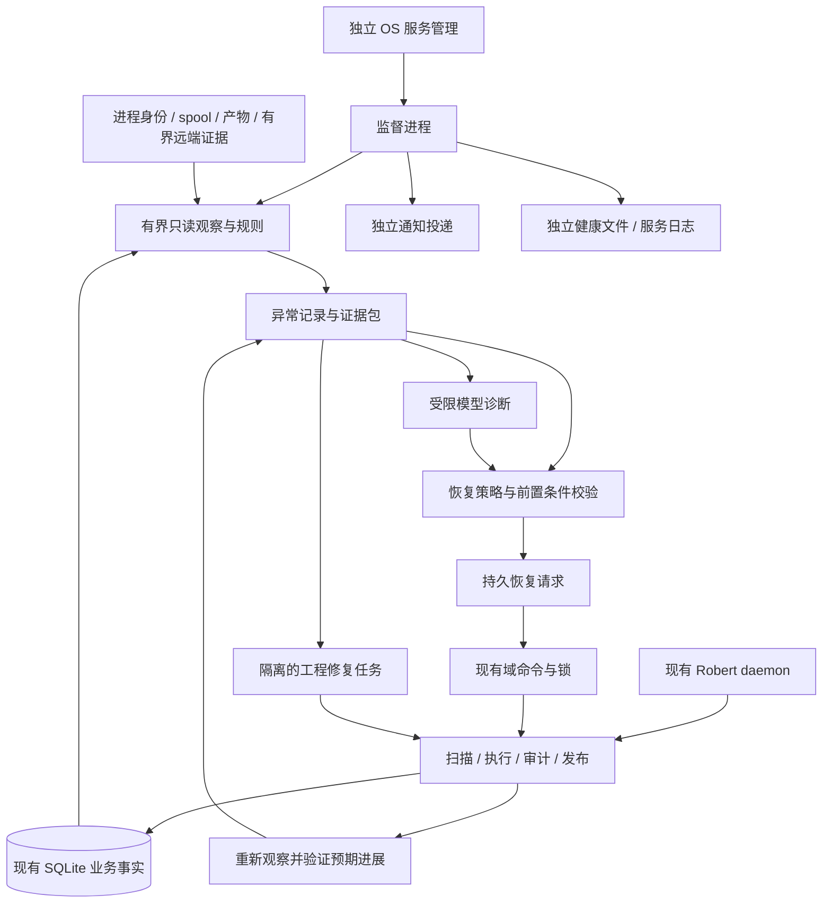

# Robert 持续任务监督与修复闭环设计

日期：2026-11-06。状态：五阶段实现随本 PR 提交，尚未部署。

以下正文保留设计时的事实与约束；实现基线已更新为 `bb360900a1d16e7462c48173c241ed8075bca113`。当前命令、配置、支持范围和模拟入口以 [运行说明](../../task-supervision.md) 为准。用户随后明确授权了五阶段实施、验证和一个 PR，每阶段一个 commit；原设计中的“本轮仅写方案”是历史范围记录。

## 1. 结论与设计基线

新增一个独立于业务 daemon 的监督进程，对已经接收的请求持续检查：有没有被接住、有没有有效进展、阻塞有没有解除、交付有没有证据。确定性规则负责发现和校验，模型负责有限的语义诊断，恢复仍经过现有控制面的授权、锁、审计和发布路径。无法恢复的 Robert 工程缺陷形成可执行的修复任务，修复后继续验证运行版本和原任务。

监督层对“异常是否得到解决”负责；现有执行层仍是任务、进程、结果和发布状态的唯一业务写入入口。保留现有 WorkItem、workstream、Task、Attempt 和 PR remediation，不重建通用 Agent 平台，不重写 Router，不迁移数据库产品。

本次读码基线为 `origin/main` 的 **`4bb50dca0e277b7e18577a00dee101855705b229`**，包含 PR #82。只读快照为 `/tmp/robert-supervision-design-20261106`。用户工作目录位于较早的 `bd0b091`，有提示词与测试的未提交改动及 `uv.lock`；本方案不修改它们。实施时须在新基线上重新核对这些未提交改动及其影响。

本轮只写设计文档，不授权部署变更、自动修复服务、GitHub 写入或合并。以下 CLI、配置、表与模块凡标注“新增”者均为拟议接口。

目标是减少人工发现和排查，成功标准是：在历史故障的重放与受控故障注入中，系统能自行发现、给出可核对证据、执行允许的恢复或形成修复任务，并在证据满足后关闭异常；不丢请求、不重复发布、不跨越取消或授权边界。

## 2. DeepSeek 设计给出的依据与边界

主依据是 DeepSeek Harness 团队的[《Super-agent 设计探索：迈向更自主的 Agent 系统》](https://zhuanlan.zhihu.com/p/2099987320443237060)。它是工程架构探索，文中实验主要检验路由和并发调度，不能作为 Watchdog 已具生产可靠性的证明。

第 6 节提出主系统之外的独立控制循环，并让 Watchdog 判断 Worker 的实质进展和目标偏离；第 3 节强调事件驱动，第 5 节强调状态持久化，第 4 节强调减少人的注意力负担。对应到 Robert：

| 原文原则 | 本方案取舍 |
| --- | --- |
| 外部控制循环 | 独立 OS 服务运行监督，不挂在 `_maybe_prune` 或主 local drain 之后 |
| 观察进展与方向 | 区分活性、可验证进展与语义判断；LLM 判断不能直接改变业务事实 |
| 持久状态 | 异常、恢复动作及验证条件落 SQLite，重启不清空预算 |
| 事件驱动 | 数据变化提供及时信号；定时巡检兜底，避免事件或唤醒丢失 |
| 少占用人工注意力 | 正常推进和成功自动恢复留记录；需决策、恢复耗尽、交付受阻才通知 |

原文允许具完整工具能力的 Watchdog 在线调整系统；Robert 初版收窄为受控动作和隔离修复任务，不直接热改运行中的提示词、数据库或权限。这个取舍来自 Robert 现有信任、进程身份、审计和发布契约。

[公开原型 README](https://github.com/deepseek-ai/dsh-superagent-prototype)明确说明与文章和内部实现不完全一致。[执行文档](https://github.com/deepseek-ai/dsh-superagent-prototype/blob/main/docs/003-execution.md)中的持久交接、有限重试、恢复前核对外部状态可参考；不假定公开原型已经实现文章描述的全部 Watchdog 能力。

## 3. 当前代码已经做到什么，缺口是什么

以下路径与行号固定指向上述基线；它们是代码事实，不代表生产当前运行状态。

| 关口 | 当前事实 | 本次要补的能力 |
| --- | --- | --- |
| Worker 活性 | `supervise.py:24` 的 `classify_attempt` 判断心跳与运行时长；启动宽限在 `run_once.py:1328`；`worker_identity.py` 判断进程身份 | 持续检查任务里程碑，发现活着却没有推进或方向偏离 |
| 恢复 | `run_once.py:532` 的 `_inspect_attempt_recovery` 使用命令、Git、phase 等证据判断死后能否续跑；此函数包含回填写入 | 独立只读观察、跨新 task/attempt/round 的恢复预算，以及恢复后的成效验证 |
| 控制循环健康 | `daemon.py:575` 的 `_maybe_prune` 调用 `reliability_health.collect`；维护开关和执行路径影响检查机会 | 监督独立运行；daemon 故障与数据库不可用仍留下外部可见信号 |
| 延迟提示 | `reliability_health.py:73` 以任务/动作创建时间筛选排队与发布延迟 | 按连续可运行时间判断，识别容量、退避、等待答复和清理等合法等待 |
| 请求衔接 | `pending_handoff.py`、`github_operator.py` 及 `run_once.py` 已有重观察、交接和新鲜源读取机制 | 检查已接收请求是否有明确处置及下一消费者，确认答复真正接续 |
| 结果提交 | `worker/result.py:202` 预审；`result_spool.py:98` 原子落盘；`run_once.py:6773` 最终审计 | 检查保存→入库→退出→审计之间的交接停滞，不把 deferred 误判成未完成工作 |
| 发布 | `publish.py:1311` 按资格选择动作；`publication_reconcile.py:417` 对账；存在有限重试和发布锁 | 检查交付证据与任务结论是否一致，对未知外部效果保持待核对 |
| PR 自修复 | `remediation.py` 按已有 PR、head/base、CI/冲突证据和预算推进 | Robert 自身工程缺陷需独立受权的修复任务，不能继承业务 PR 的修复权限 |
| 通知 | `notify.py:78` 有受控命令、脱敏、delivery ID、重试和通知锁；daemon 的 cutover 路径也有直发 | 独立投递者保证主循环停摆时仍能送达；DB 不可用另有有界健康出口 |
| 诊断 | `diagnostics.py:80` 导出状态、最近运行和脱敏配置摘要 | 按异常收集目标、因果链、相关版本与证据，形成可处理的诊断包 |

`loop_engine.snapshot_progress` 是 drain 的计数型停止条件，不是单任务语义进展。`worker/snapshot.py` 中 summary 或 next_step 改变会生成新记录，也不自动等价于目标推进。

## 4. 整体结构

新增拟议命令：`robert supervisor run`、`robert supervisor check --output json`、`robert supervisor status --output json`。`check` 默认只读并报告候选；`run` 按模式写入监督记录。异常详情与受控操作沿用现有 Workbench/CLI 风格，不另建业务看板。

独立监督进程是一个有界观察器和动作请求者，不是第二套业务调度器。正常任务的进程启动、结果恢复和发布仍由现有控制面完成。主控制面停摆时仍能诊断和告警；首版不承诺在控制面完全损坏时继续执行工程修复或自动接管其租约。

## 5. 身份、进展与等待的明确契约

### 5.1 谁对同一个请求持续负责

- WorkItem：面向人的汇总和异常展示单位。`work_items.py:273` 沿 origin workstream 归属。
- workstream：串行协作域。数据库限制同域一个活跃任务。
- Task / Attempt / review round：具体执行对象，不是恢复预算的稳定归属。
- 新增 `lineage_key`：同一逻辑请求的恢复链身份，放在任务及相关轮次的持久元数据中，通过明确的创建参数传递。

GitHub 请求以本次明确的新驾驶事件 fingerprint 起键；Web 请求以持久请求事件/创建幂等键起键；已有 CI/冲突修复以 episode 身份起键。失败任务后的新追问可能同时携带历史 trigger 作为上下文，不能从输入列表的第一条 trigger 推导 lineage。分类转编码、同请求的答复接续、自动恢复及 Retry/Retrigger 生成的替代对象均继承原键。独立的新请求另起键。

`parent_task_id` 也用于历史关联，不能单凭父链推导同一请求。用户 Retry 表示再次尝试，默认不清账；确需扩大自动恢复预算，应作为带操作者和原因的单独决定记录。新 round、新错误文本、新 daemon run 都不能清空预算。

每个 lineage 同时受阶段累计上限和总自动恢复上限约束。业务域已有的更严格限额仍然生效。只改变错误分类不能绕过总预算。旧任务无法可靠还原 lineage 时先只观察，不猜测后自动恢复。

### 5.2 三类信号不能混用

| 信号 | 示例 | 能否重置进度计时 |
| --- | --- | --- |
| 活性 | 心跳更新、进程存在、日志增长、模型输出更多 token | 不能 |
| 可验证进展 | 请求进入下一消费者；命令完成且形成新验收证据；封存阶段成功；同一结果入库/审计；指定动作得到回执 | 可推进对应里程碑，但仍受总时限约束 |
| 语义判断 | 模型根据目标和证据判断重复探索、策略无效或方向偏离 | 作为可解释的诊断意见，不伪造业务完成证据 |

失败命令换 UUID、重复运行同一失败测试、重写摘要、反复改无关文件都不能自动算作有效进展。命令完成只是活动事实；只有与当前阶段验收相关的新结果才推进里程碑。CLI 缺少完整工具轨迹时明确标记观测不足，不能假装知道它在做什么。

拟议只读投影：`ProgressFact(stage, evidence_kind, evidence_id, digest, observed_at)` 与 `WaitFact(reason, blocker_id, condition, eligible_after, evidence_at)`。不要将这些投影写回 `task.lifecycle`。

### 5.3 合法等待与停滞

使用 `eligible_since` 表示前置条件持续满足的时间，而不是直接使用 `created_at` 或 `updated_at`。退避、未到 not-before、容量不足、人工暂停、未答问题、远端尚未完成的 CI、进程清理及当前授权不可用，分别展示原因和下一检查条件。

条件不满足时停止累计“可运行却没运行”的时间。等待条件解除后，允许至少一个对应消费者的正常执行机会，再判断停滞。等待本身超过用户明确的交付时限可以升级提醒，但不能绕过等待条件启动任务。

已回答问题还需要 child/resume 或明确拒绝证据。`record_github_response` 早于后续 Git I/O 和建任务，单看问题已答不足以关闭异常。

## 6. 第一批监督规则

规则结果统一为 `healthy / expected_wait / suspect / confirmed / unobservable`，附证据、等待条件与下一检查时间。确定性矛盾可直接 confirmed；单纯时间较长一般先 suspect。LLM 意见不能单独授权停止进程或发布。

| 规则 | 判定依据 | 必须排除的情况 | 处理方向 |
| --- | --- | --- | --- |
| `source_unobserved` | 应运行的扫描持续失败、观察范围/游标长期未推进 | 预定轮询、配额退避、关闭的来源 | 记录源覆盖缺口；按来源规则恢复/告警 |
| `accepted_input_unowned` | 已接收驾驶事件无任务、轮次、pending handoff 或明确处置回执 | context-only、拒绝、不完整历史数据 | 核对当前授权及所有权；请求已有消费路径再检查 |
| `ready_not_dispatched` | 前置条件满足且消费者已运行，仍无 attempt 启动 | prompt/worktree 缺失、容量、not-before、清理、暂停 | 区分缺前置条件、调度遗漏与未知占用 |
| `worker_state_mismatch` | 任务标记运行而已证明进程组退出，或结束任务仍有被占用进程 | PID 复用、未知身份、仍存活子进程 | 调用现有监督/退出核对路径；未知身份交人工 |
| `worker_no_progress` | 活性存在但阶段里程碑长期不变、同类失败反复出现 | 合法长命令及证据不足 | 有界语义诊断，提出等待、反馈或恢复建议 |
| `handoff_stalled` | 分类/答复/已结束执行已有后续输入，但对应消费者未接续 | 正常退避、当前 workstream 有其他所有者 | 复用 pending/classification handoff，验证 successor |
| `result_not_consumed` | durable spool/result 已存在，未进入对应 ingestion/audit | 活进程/组未退出、spool 锁、audit 退避 | 重放/推进现有结果，不再启动编码 Worker |
| `publication_stalled` | accepted 动作具备发布资格且到期，消费者有机会但没有回执 | 动作顺序、退避、审计拒绝、attention、未知副作用 | 同 action/intent 远端对账，必要时原动作重试 |
| `delivery_inconsistent` | 新完成任务的声明与路由要求的提交/审计/回执矛盾 | 合法无动作任务、批准本地交付、superseded/retired | 保留历史，记录异常并核对交付；不伪造成功 |
| `recovery_ineffective` | 恢复动作执行后未达到其预期条件，或相同失败再次出现 | 尚在明确验证窗口 | 消耗同一恢复预算，换有依据的策略或升级 |
| `controller_or_notice_stalled` | 控制器失去进展、lane 熔断、关键通知耗尽、监督覆盖过期 | 计划停机/维护窗口 | 独立诊断和投递，避免触发重启风暴 |

输入回执是必要补点。当前 `authorization_status` 可能保留历史授权，原生轮次可以先于 task，成功 scan batch 会清理；不能写一个“没有 task_events 就丢单”的 SQL 当完整检测。

新增轻量 admission receipt，分成两个提交点：`received` 与驾驶事件首次接收同事务持久化，必须先于释放事务做 Git I/O；`disposition` 与实际创建 task/round/pending 或明确拒绝同事务落账。处置包括 `admitted_task / queued_native_round / linked_pending / explicitly_ignored / deferred`，含输入版本、目标 ID、原因和责任消费者；deferred 必须有到期条件，不能因为存在这个值就视为已接续。这样可以发现事件已提交、准备或创建任务前崩溃的窗口。

receipt 记录处置证据，不授予权限、不取代现有 consumed 标记。完全没被系统观察到的外部请求只能报源覆盖问题；要证明漏掉具体请求，需另有独立来源对账或 canary。

完成检查只针对新交付、未决交付和受异常影响的对象，使用当时固定的输入/提交版本。不要反复用当前 PR HEAD 检查历史成功提交，否则正常后续更新会被误判为旧交付失败。`delivered`、`superseded`、`retired`、`local_complete` 分开解释。

具体做三方核对：路由/expected_output 的要求、结果中 `metadata.normalized_payload.planned_github_actions` 的计划、同 result 的 audit/action/intent/交付回执。没有 action 行不能直接判为合法无动作，因为计划动作可能在交接中丢失。合法 dedup 必须匹配目标、版本与身份；历史证据缺失显示 unknown。代码语义正确性另需与输入版本绑定的验收与复核证据，状态/hash/Worker 自述成功本身不够。

当前 `publish._mark_published` 会把 intent 的远端证据替换为通用 publisher_success，不能假设全部成功记录都有完整 SHA/marker。实施时在成功分支补结构化回执：action/result/scope、推送 SHA 或外部对象 ID/marker、确认方式和时刻，与发布完成记录一起持久化。保留有效的对账证据，不用泛化成功标记覆盖；没有实际观测的历史数据不补造。

## 7. 最小持久化模型

通过 `storage.py` 与 `resources/db/schema.sql` 做加性迁移。新增三个监督表，不增加第二个业务数据库，不把监督状态塞入现有 task lifecycle。

### `supervision_checkpoints`

按 `(scope_type, scope_id, rule_id)` 唯一保存观察位置，字段包括：`lineage_key`、输入/状态 generation、源 cursor、`progress_digest`、`last_progress_at`、`eligible_since`、wait fact、`next_check_at`、证据引用和 schema/rule 版本。服务本身的扫描游标也是一种 scope。

admission receipt 采用固定 `rule_id=admission` 的事件 scope checkpoint；`received_at/input_generation` 由接收者写，`disposition/target/consumer/due` 由业务处置者写，观察 digest/时间/due 由监督者写。接纳和处置分别与各自业务事务一起提交，带输入版本 CAS，禁止整行覆盖或旧处置覆盖新输入。原始业务事实仍在现有表中。

### `supervision_incidents`

保存 `incident_id`、scope、lineage、稳定规则/失败类别、severity、状态、首次/最近观察、下一检查时间、证据包引用/hash、结论及关闭证据。关联对象列表保存 task/attempt/round/action 的历史和 successor，供展示与验证；不是新任务所有权。

状态为 `open → diagnosing → recovering → verifying → resolved`；允许进入 `needs_attention`，人工或新证据可使其重新诊断。`dismissed` 必须有原因；用户取消/问题已不适用用关闭原因表达，不能算自动恢复成功。重复观察只更新同一开放异常，已解决后再次复发产生关联的新 occurrence，旧账保留。

观察模式下，open/diagnosing/needs_attention 也可以依据新的正向业务证据直接 resolved，记录 `resolved_by=natural/operator/supervisor`。对象读不到、证据过期或暂时没有看到错误都不是解决证据。

去重键以稳定 scope + lineage + rule/failure family 为主，不能含 attempt ID、错误时间、随机 UUID。controller/来源问题按安装实例与 lane/source 聚合；原因相同但证据不足时只关联疑似关系，不把多个仓库的独立问题强行合并。

### `supervision_recovery_actions`

保存 `action_id`、incident/lineage、动作类型、稳定幂等键、目标 ID/generation、政策版本、前置条件摘要、预期验证条件、状态、预算消耗、创建/开始/结束时间、域命令回执和验证证据。

动作状态为 `proposed / requested / applying / observing / succeeded / failed / rejected / unknown`。`requested` 和 `applying` 均不是修复完成。没有拿到动作回执时先按稳定键对账，不重新生成动作。副作用无法确认时进入 unknown，阻止并发新恢复。

动作键在同事务中按 `(lineage, scope, action_kind, recovery_ordinal)` 分配并唯一约束，重投复用原键；正在 requested/applying/observing/unknown 的 scope 保持互斥占位。执行者 claim 带单调 fencing generation、持有者和截止时间；claim 到期本身不证明原执行者已停，接手前仍核对进程身份及域回执。unknown 占位不自动到期释放。

按 lineage/stage 统计已预留/执行动作形成预算；阶段及总预算同事务检查并预留，不能先执行再计数。只有证明未发生副作用的拒绝才可释放预留；可能执行过的动作保留次数和占位。启用某类自动恢复前，其相关原生恢复入口也必须在副作用前使用同一 claim/预算门禁，并保留原生更严格限额；事后补回执不能实现仲裁。尚未改造的路径只能观察或唤醒原消费者，不另发重试。未结案及仍可恢复 lineage 的预算记录不能被定期清理重置，归档须保留累计账。

必要索引包括开放异常的唯一聚合键、due checkpoint、due recovery action、lineage/action 状态查询。对反查 `task_events.event_id` 等现有表的索引需求，先用代表性数据和 `EXPLAIN QUERY PLAN` 证明，不每轮 JSON 扫描全部历史。

## 8. 独立控制循环与故障隔离

每轮顺序：

1. 检查 supervisor 单实例文件锁和服务预期状态；读取受信任配置。
2. 用只读连接收集到期对象的短快照，记录覆盖范围与源 generation。
3. 释放数据库读事务后，做有界进程/Git/文件检查；远端读取遵守现有配额与缓存规则。
4. 纯规则生成观察结论；短事务重读并核对 generation，再更新 checkpoint/incident。
5. 为需要解释的异常或到期长任务排队诊断；诊断子进程不阻塞下一轮基础监督。
6. 通过恢复策略生成或验证动作请求；实际业务变更由现有域消费者执行。
7. 调度独立的有界通知投递，保存本轮健康信息与下次 due。

初始工程参数建议：60 秒一轮、每轮最多 100 个候选、纯观察轮墙钟预算 10 秒；昂贵检查另设子预算并跨轮续扫。参数是待回放校准的初值，不是现有生产 SLA。索引分页和公平游标保证大队列不会永久只查最老的 100 条；报告最近完整覆盖时间。

恢复 I/O、通知和诊断均不能阻塞基础观察线程。投递按通知锁在独立有界子任务中执行，具备进程清理和独立时间预算；现有 `deliver_pending` 的内部 deadline 不等于整个 tick 的上界。慢通知命令、SQLite lock 和 GitHub 退避都要测试基础 tick 仍会前进。

`mode=ro` 读取 WAL 中当前事实，不使用会忽略活动 WAL 的 immutable 方式。不要长时间持有读事务来跑 LLM、Git 或网络。普通 tick 不调用数据库初始化/迁移，不导出全库，不对所有任务不断写心跳。

主库不可读、迁移中、schema 不兼容或写入失败时，标为 `unobservable`，停止业务恢复，不把未读到的结果当成不存在。在数据目录写一个 0600、原子替换的 `supervisor-health.json`，仅含安装/服务身份、检测时间、最后成功覆盖、错误类别和稳定的系统告警 ID。必要的待投递摘要保持有界。这个文件不是备用任务数据库。

独立服务日志始终记录降级；已配置通知出口时使用与普通投递一致的完整 `delivery_id`（含现有内容摘要），在健康文件中先记录 sending/次数再外送并记 ACK。恢复后把已送达记录连同 `metadata.delivery` 归档，不重新排成待发送；结果不明只以相同完整 ID 重投，由接收端去重。无通知出口时显示 `notification_delivery=not_configured`，不能称为已通知。DB 不可用时不调用先外送后写库的 `notify.send_notification`。若健康文件所在文件系统也不可写，保留服务日志并明确无法保证跨重启去重，不承诺 exactly-once 通知。

主 daemon 增加一个轻量原子 tick 标记，含 run/启动身份、PID 身份、构建标识和最近完成 tick；它证明控制循环执行机会，不证明业务进展。按配置/安装实例关联 lease，不能使用全库 latest daemon，也不能把 lease 到期当成进程死亡证明。

supervisor 使用 systemd/launchd/Supervisor 的独立服务项，安装、启停、状态和卸载都要覆盖。当前 Supervisor 后端的 service stop 是 supervisorctl shutdown；实施须新增按 daemon/supervisor target 的控制入口，保留全栈 stop 的明确语义，验证仅停止 daemon target 时监督仍在线。计划维护/明确停机需要受信任的状态标记，避免反复告警。服务管理器负责重启监督进程；同一主机完全断电不在同机监督能力内，外部存活探针作为后续运维能力。

## 9. 模型诊断：输入、输出、资源与权限

模型只在规则无法解释的异常、重复无效恢复、到期长任务方向检查或交付争议时调用。长任务需周期性的语义抽查，不能只在报错时触发，否则方向持续偏离却不断产生输出的任务会漏检。

诊断输入是固定证据包：原始目标/当前授权范围、路由与验收要求、固定输入版本、阶段里程碑、等待事实、最近有限命令/测试/结果、已有恢复账、当前构建及配置摘要、明确缺失项。复用 `diagnostics` 的脱敏逻辑，但不把完整数据库、整个日志目录或凭据送给模型。

证据包先登记可访问路径和 hash；诊断进程必须返回读取的包 ID/hash。模型输出为结构化建议：`diagnosis_class`、引用的证据 ID、已确认事实/假设、`recommended_action` 枚举、目标版本、预期进展、下一复查时间与人工决策。解析失败或无证据引用不能执行动作。

默认编码 adapter 具有较大本机权限，不能原样作为“只读诊断”运行。优先用现有 `command` adapter 构造管理员配置的无工具模型包装程序：stdin 输入脱敏包，stdout 输出建议，无主库写入口、无 GitHub 写工具。若使用能执行工具的诊断 CLI，必须有可验证的 OS/CLI 限制；提示词不构成权限边界。未配置合格 profile 时继续确定性诊断，并明确语义检查未启用。

command adapter 只是命令构造器，包装程序本身必须可信。诊断使用专用环境白名单与私有临时 cwd/HOME，仅显式加入模型调用所需配置，不继承编码环境中的业务凭据和写工具配置；这仍不是操作系统沙箱。模型没有工具时只生成文本，执行约束由包装程序保证；工具型 profile 必须另外验证实际隔离，不能宣称临时目录足以隔离本机文件。

独立诊断最多 1 个子进程，建议单次 120 秒上限、每 lineage 10 分钟冷却，并有安装实例的小时调用预算；确切阈值回放校准。只复用 adapter 命令构建、环境白名单和进程身份机制，不经过主任务队列，所以主调度卡住时仍可解释已有快照。LLM 不可用不影响确定性检测和告警。

诊断的启动 claim、进程身份、截止时间和小时预算保存在 diagnostic scope 的 checkpoint 中，在 spawn 前预留；supervisor 重启先核对旧诊断进程组，未证明退出前不启动第二个。主库不能记录 claim 时不启动新模型诊断，仍用已有健康快照做规则诊断和告警，避免通过重启或故障绕过预算。

模型不能生成任意 shell 恢复命令；不直接修改 SQL、取消任务、杀进程、扩大权限或推送代码。模型结论与业务证据分开保存。错误文本和外部任务内容始终按不可信数据处理。

## 10. 恢复动作与仲裁

首先观察现有内建恢复是否正在进行，并等待其 not-before/验证窗口。新监督层不能再给每次内建失败追加一组重试。

| 故障位置 | 使用的恢复路径 | 成功验证 |
| --- | --- | --- |
| 已持久提交尚未入库 | 请求原消费者执行 `worker.result.replay_pending_results` → `result_spool.replay`，保留同 attempt/fingerprint | 原结果与对应 wakeup 入库，不产生新 Worker |
| 结果等待审计 | 遵守现有审计重试；耗尽保留人工决策，初版不自动清 audit_observation | 同 result 获得最终判定；accepted 才能进入发布 |
| 发布超时或响应不明 | 同 action/intent 由原 publisher/reconciliation 处理 | confirmed effect 补回执；confirmed absent、原预算未耗尽且当前范围允许才重放；unknown 升级 |
| 已确认死 Worker | 现有监督、进程组退出证明和恢复资格判断 | 原请求产生合法 successor 并出现新里程碑 |
| 过期 review round | 保留旧 round；受控新轮读取当前 revision | 新轮与当前输入绑定，旧快照不被覆盖 |
| 接续/准备停滞 | 现有 handoff/operator preparation 消费路径 | 同请求被正确 successor 接收，原事件不被吞掉 |
| 长任务可能空转 | 先诊断；无标准运行中 steering 接口时不直接注入 stdin | 等到既有安全交接点后反馈诊断，或交人工决定是否终止并续跑 |
| 主控制器/DB 异常 | 独立诊断、告警、保留证据 | 主控制恢复、覆盖刷新及受影响任务重新推进；首版不自动清 latch/重启服务 |

Supervisor 提交带 target/action ID 的 typed request，由现有 repo/phase consumer 在自己的锁内领取。当前 replay 和 publish 的入口有批量语义，不能把它们当成单 action 授权后直接调用；需要独立精确处理时先抽取共用的目标级消费者能力。禁止旁路调用低层 `_publish_action`、`_mark_published` 或整轮 run_once 来实现一次局部授权。仅唤醒消费者不授予额外重试次数。

每个动作的执行协议：短事务检查并预留 claim/预算；消费者取得自己已有的 repo/task/result 锁后，在实际执行边界重新检查当前授权、输入 generation、所有权、暂停/取消/终态、现存 result/action 和 claim fencing；不满足则只有确认未执行时 rejected；保存域回执后进入 observing；看到预期条件后成功。不能在外层先持同一 flock 再调用内部获取该锁的 API，避免自锁。非 DB 的事实尽量在副作用前重验，仍沿原 publisher 的模糊效果对账契约处理不可消除的外部竞态。

域变更与 action 回执能共享事务时原子提交；跨文件/远端副作用沿现有 intent/回执核对。没有原子回执或按原幂等键查询效果能力的动作不得启用自动执行。崩溃后不能依据 `applying` 假定成功或失败；可能已执行则 unknown，保留预算和占位，按原键对账。监督器失去文件锁或目标版本改变时拒绝旧建议。不同监督实例及人工操作同时发生时，也只能有一个恢复胜出。

现有 `retry_publish` 不解锁 retryable=False 或 intent attention。审计的人工 Retry 会重置 observation 预算，也不能直接用于自动恢复。预算耗尽仍可在独立探测预算内做只读对账，不能据此重发；未来若扩大自动恢复权限，必须显式定义新预算批准，而非清空旧字段。

系统恢复身份为新增受限的 `system:supervisor` capability，不伪造现有 maintainer/operator 身份调用 Retrigger。允许的 action、repo、lineage 和策略版本由受信任配置给出，域命令继续验证原始用户授权；诊断文本不授予新权限。

初版默认 `observe`；允许 `recover_known` 后只启用逐项验收的恢复动作。人工停止、明确取消、未知进程身份、未知发布效果、授权撤销和未知 lineage 一律不自动越过。协议拒绝、不可修正的内容错误不自动重试相同输入。

## 11. 工程缺陷修复闭环

现有 `pr_remediation_episodes` 解决受管理 PR 的 CI/冲突，不代表有权修改 Robert 自身。新增异常到修复任务的桥接，静态配置维护目标仓库、允许的本地写入/提交/PR 动作和预算。

1. 诊断确认可能是产品缺陷时，生成包含基线、症状、触发条件、证据、复现方式、影响范围和验收条件的修复工作说明。假设明确标注，不把 LLM 猜测当作已复现根因。
2. 优先通过 `work_items.create_work_item` 的 creation idempotency 形成本地待办，`start=False`。只有维护策略允许自动实施时才经系统专用受限入口启动标准修复流程。
3. 在独立 worktree 修复，使用现有 Worker、回归测试、结果协议、审计和 publisher。路由由策略确定，不能让错误日志经过 `infer_intent` 自动得到写入权限。
4. 多个 incident 可关联同一个已确认根因的修复任务；一个 incident 不随 attempt 生成多个 PR。修复任务自身失败回到同一异常链并消耗既定预算，不递归创建“修复修复者”的任务。
5. 修复交付后分别记录：代码修复已验证、进入目标分支、运行版本包含修复、原任务已恢复。每步都有证据，不压成一个 completed。

现有 new-pr 路由要求 push/open PR，而 local-result 不准备代码 worktree。因此初版只有本地权限时只建待办，不假装已有“自动本地修复但不发布”的完整路由。自动实施仅在所需动作全部受权时复用 new-pr；若之后确需 local-only 编码，必须另行定义其 worktree 与结果契约。维护策略 generation 在 admission、dispatch、最终审计和每次远端副作用前复核，不能只在启动入口检查一次。修复验证要保存绑定修复 SHA 的实际命令、exit code 和输出证据；不能只信 verification 字段写了 passed。

自动修复还需专用受限执行环境：独立 worktree 只负责工作隔离，不能隔离本机权限；受限服务账户/沙箱负责限制主库、策略文件和发布凭据访问，远端写入由 publisher 完成。限制未验证时维持本地待办。验收命令由受信任仓库策略或人工核准，受控验证进程记录被测 SHA、命令及 exit code；复核绑定同一 SHA，后续 commit 使受影响的验收证据失效。

主控制器完全不可用时只能持久形成修复请求和证据，状态显示待控制面恢复；第一版不在旁路再建一套可发布代码的执行引擎。后续若确有独立维护执行环境，再单独设计其权限与交付边界。

进入目标分支以 provider 的 merge/squash/rebase 结果及包含关系验证；cherry-pick 要有明确映射，不能只查原 head SHA。部署证据需由可信构建/安装流程生成 manifest（source revision、产物 digest、是否 dirty），绑定实际受影响 live daemon 的启动/加载身份；supervisor 自身的 manifest 不能代替主 daemon。当前静态 `__version__`、工作目录 HEAD 或 `robert --version` 都不足以证明某修复运行中。

原任务可安全续跑时验证同 lineage successor 的具体交付回执；仅出现一个新的健康 tick 不够。无法安全复跑时分别展示“受控回放已验证 / 原任务未恢复”；用户取消、来源关闭或已不适用时记录明确结案原因。部署自动化不属于首版授权；缺部署证据时保持待验证。

## 12. 用户反馈与运维可见性

WorkItem 继续展示真实业务状态，同时增加监督摘要：异常、证据、影响、已尝试恢复、下一检查时间和需要用户决定的事项。incident 不自动改写整个 WorkItem 为 failed，也不把人工应答混入普通系统提醒。

系统级异常展示在全局状态区；任务级异常挂在原任务卡片。按钮按现有控制事实投影，例如查看证据、允许一次受控恢复、暂停自动恢复、转为修复任务、标记不适用。按钮操作仍验证身份、版本、CSRF 和幂等键。

通知策略：可自行恢复的候选先安静记录；需决策、恢复预算耗尽、确定交付失败或系统不可观察时通知；相同异常不按 tick 重发。通知 ID 由 incident + 有意义状态迁移/版本构成，不能只修改 safe_error 期待现有 delivery digest 重新发送。

复用 `notify.deliver_pending`，独立调用与原调用共享通知锁。对与新规则重叠的 `reliability_health.collect` 告警逐项移交唯一 owner，保留它的其他健康指标，避免两套通知。模型建议反馈到后续合法的恢复 prompt，并注明所依据的旧证据和当前待验证事实；不能暗中扩大任务目标。

指标至少包括：首次发现延迟、确认误报率、异常到诊断/恢复耗时、恢复验证成功率、人工首次发现比例、重复异常/通知/PR 数、观测覆盖年龄、DB/CPU/模型开销。没有生产基线前不承诺降低多少百分比；故障回放给出规则级覆盖结果。

## 13. 实施顺序与模块边界

建议拆成五个可独立验收的阶段。按顺序交付，每阶段保留前阶段能力；无需等待全部完成才开始发现问题。

### 阶段 A：独立观察与可行动异常（首个可上线版本）

- 新增 `supervisor.py`、`supervision_store.py`、`supervision_observe.py`、`supervision_rules.py`，分别负责服务、持久账、只读投影、纯规则，避免继续把逻辑堆入 `run_once.py`。
- 修改 `storage.py`、`resources/db/schema.sql` 加三表；`cli/main.py`、`service.py`、`doctor.py` 提供独立启停/健康检查；配置 schema/example/validator 加最少模式与轮询入口。
- 首批使用现有事实支持的 controller、worker mismatch、result、publication、已知 handoff 规则；不可靠的 intake 缺关联只作为候选。
- 独立通知投递、健康文件和原有 health 重叠告警移交；增加 `status.py`、`board.py` 的只读异常投影。
- 验收：主 daemon 被暂停执行或异常退出时监督仍运行；通知不依赖 publisher；SQLite busy 时不会误恢复；合法等待不报失败；重复检查只创建一个 incident。

### 阶段 B：补齐请求回执与进展语义

- 在 `run_once.py` 的 event disposition、classification/ordinary handoff、native enqueue、operator continuation，以及 `work_items.py` 的命令创建处写入 lineage/receipt；只改必要生产者，保留现有 consumed 与授权语义。
- 从 `github_operator.py`、prepared admission 和 publisher 中抽出可复用的纯资格事实，避免监督器复制且逐渐偏离业务门禁。
- 使用 `execution_metrics.py` 的阶段时间，新增连续 eligible 时间和稳定 progress token；旧数据只观察。
- 在 `publish.py` / `execution_store.py` 的成功持久化边界保存结构化交付回执，保留原有 reconciliation 证据，用计划/实际/回执三方核对覆盖丢 action 与合法零动作。
- 验收：事件落库后、任务准备前崩溃仍可发现；已答却未接续可发现；native round 先入队不会误报；同请求换 task/round 不重置预算；同 Issue 的新独立请求不继承旧预算；新发布的结构化回执与被审计版本一致。

### 阶段 C：受限诊断与定期语义检查

- 新增 `supervision_diagnose.py` 和独立诊断 prompt/输出契约；扩展 `diagnostics.py` 生成按异常的脱敏证据包。
- 用明确诊断 profile 复用 `worker_adapters` 的 command 构建；加独立子进程生命周期、单并发、时间/调用预算和失败降级。
- 验收：能够解释重复失败及目标偏离；证据包实际可读、hash 对应；不可信日志无法授予动作；模型退出/失联不影响基础巡检；主调度卡住时诊断仍可完成；诊断运行中 kill supervisor 后重启不会产生第二进程或重置额度。

### 阶段 D：已知恢复与后续验证

- 新增 `supervision_actions.py`，实现 typed action → 现有域命令的受限桥接；在 `execution_operations.py`、`run_once.py`/`work_items.py` 必要入口接受显式 capability 与 lineage，但保留原检查。
- 将相关原生恢复入口接入执行前的共享 claim/预算门禁，并把回执关联到同一个监督账；尚未接入的动作只观察/唤醒原消费者。域内恢复完成后按 expected progress 进入验证，不能仅凭命令返回 0 关单。
- 逐项启用 spool/audit/publication/handoff 的已知动作；worker replacement、superseded 新轮须单独通过身份与预算测试。
- 验收：重启/并发/人工取消与结果到达竞态不重复动作；未知外部效果只对账不重发；恢复不成功会升级；现有更严格配额不被绕过。

### 阶段 E：工程修复任务与部署验证

- 增加 incident → WorkItem 的维护策略入口与修复工作说明；复用标准 Worker/审计/发布，不扩张 PR remediation 的权限。
- 加构建/运行标识及修复关联状态，展示代码、主线、部署、原任务四层验证。
- 验收：相同根因只产生一个受权修复任务；未配置实施权限只生成本地待办；修复失败不递归；修复只进旁支/主线未部署/运行版本不明均不会误关闭原异常。

每阶段的具体文件所有权按上述模块划分；存储字段与纯资格事实接口先定，再做规则和 UI，动作桥接最后接入。若并行实施，禁止多个 worker 同时改 `run_once.py`、schema 或 service；由一个集成者持有共享文件。

## 14. 验证矩阵与历史案例

已有修复 PR 代表历史故障，不意味着当前基线仍有缺陷。重用其回归 fixture 或构造受控事件序列，验证监督层能识别这些类别；不要把生产代码改坏来演示。

| 场景 | 监督验收 |
| --- | --- |
| #71：控制循环反复失败 | 聚合一次 controller incident；正常其他 lane 不掩盖失败 lane；独立通知；不重启风暴 |
| #72/#74：操作已接受却无人消费 | 有 receipt 且无 successor 时发现；未观察外部请求只报覆盖不足；不重复建任务 |
| #75：暂停准入仍有进程/结果 | 继续观察和退出核对；不恢复新准入、不擅自发布或消除人工暂停 |
| #78：相同审计拒绝反复提交 | 聚合原因与字段位置；保留成功产物；内容未改变不重复提交 |
| #79：重试使用旧快照 | 绑定旧/新 round 和输入 revision，验证读到新版本后才算恢复 |
| #81：dirty worktree 假交付 | 首先由当前提交/最终审计门禁拒绝；监督识别拒绝后的停滞，针对损坏的交付回执 fixture 检查不一致；合法去重和无动作任务不误报 |
| #76/#80：修复进错目标分支 | 修复任务完成与进入目标分支分开；运行构建未确认时仍待部署验证 |
| 正常慢任务、配额、CI、等待答复 | 显示等待条件；不误杀、不消费恢复次数 |
| supervisor 与人工取消/新结果并发 | 版本校验拒绝过期动作；结果与历史证据保留 |
| kill/restart 于动作各阶段 | 相同幂等键对账，预算不重置、无重复发布 |
| SQLite busy/损坏、通知出口失败 | 降级可观察，业务变更停止，恢复后不重复通知 |
| 规模与公平性 | 大量已结束任务不拖慢活动检查；due 分页最终覆盖全体；测查询计划/写入次数和 tick 耗时 |

现有测试入口可复用：`tests/test_cutover_recovery.py`、`tests/test_lifecycle_remediation.py`、`tests/test_pending_handoff_recovery.py`、`tests/test_github_board_recovery.py`、`tests/test_github_scan_remediation.py`、`tests/test_retrigger_preparation_retry.py`、`tests/test_contract_matrix.py`、`tests/test_review_coordinator.py`、`tests/test_work_items.py`、`tests/test_daemon.py`。新增对应监督规则、存储、服务、诊断、动作和集成测试，不为简单字段搬运编写镜像实现的测试。

测试使用可控时钟、隔离临时数据库、真实有限子进程和 fake GitHub/模型。先离线回放，再在只读生产备份上校准误报与成本；不对生产任务做故障注入。

代码阶段必须运行 `python3 -B -m unittest discover -s tests`；按仓库 CI 跑 Ruff、现有 mypy 范围、compileall；打包/资源变更跑 `python3 -m build`，独立安装验证新增 supervisor 命令与服务资源；`git diff --check`。服务和诊断 profile 必须做真实受控启动验证，mock 不能证明权限或进程清理正确。跨平台服务生成与进程身份覆盖 Linux/macOS，Python 版本矩阵沿用 CI。

本次仅写方案，没有运行应用测试或生产验证；文档只检查引用、格式与方案一致性。

## 15. 上线、兼容与回退

迁移一次性执行，新增表和元数据均加性；新 supervisor 遇到旧 schema 只报告缺迁移，不自行初始化。旧 daemon 在观察模式可继续运行，但新增 receipt/lineage 覆盖不足时规则要明确降级。

先上线 observe，记录覆盖与误报；再启用受限语义诊断；达到回放验收后按恢复动作 allowlist 开启 `recover_known`。自动工程修复另有目标仓库和动作范围，不因启用监督就默认获得。

回退先禁止新动作、停止/收尾诊断子进程；正在 applying/unknown 的动作必须保留并对账，不靠删除表、回滚数据库或清空 incident 解除。关闭新规则后旧健康告警 owner 可恢复，但未决异常与恢复账保留。recover_known 只在所有相关业务写入者声明支持当前 claim/fencing 协议时启用，混部未知版本降级为观察。回退到旧 daemon 前，不仅确认进程结束，还必须完成非终态动作及未知效果对账；否则经现有域机制将相关目标保持禁执行，不能让旧写入者忽略新占位后重试。无法保证这一点时暂不回退业务写入者。

首次实施需要核对实际服务后端、安装实例、通知出口、诊断 profile 和部署版本记录方式。这些不是当前代码调查能够证明的运行事实。默认策略为：观察开启、自动业务恢复关闭、诊断 profile 未验证则不启用、工程修复只生成本地待办。阈值通过历史回放与观察期校准，不直接照搬 DeepSeek 的参数。

## 16. 阅读代码的固定入口

以下链接全部固定到设计基线，避免与本地旧分支或未来 main 混淆：

- [Worker 活性判断](https://github.com/wklken/Robert/blob/4bb50dca0e277b7e18577a00dee101855705b229/src/robert_agent/supervise.py#L24)
- [死后恢复证据检查](https://github.com/wklken/Robert/blob/4bb50dca0e277b7e18577a00dee101855705b229/src/robert_agent/run_once.py#L532)
- [现有健康采集](https://github.com/wklken/Robert/blob/4bb50dca0e277b7e18577a00dee101855705b229/src/robert_agent/reliability_health.py#L73)
- [维护循环触发健康采集](https://github.com/wklken/Robert/blob/4bb50dca0e277b7e18577a00dee101855705b229/src/robert_agent/daemon.py#L575)
- [独立通知可复用入口](https://github.com/wklken/Robert/blob/4bb50dca0e277b7e18577a00dee101855705b229/src/robert_agent/notify.py#L78)
- [WorkItem 归属](https://github.com/wklken/Robert/blob/4bb50dca0e277b7e18577a00dee101855705b229/src/robert_agent/work_items.py#L273)
- [提交验证](https://github.com/wklken/Robert/blob/4bb50dca0e277b7e18577a00dee101855705b229/src/robert_agent/worker/result.py#L202)
- [发布资格](https://github.com/wklken/Robert/blob/4bb50dca0e277b7e18577a00dee101855705b229/src/robert_agent/publish.py#L1311)
- [远端效果对账](https://github.com/wklken/Robert/blob/4bb50dca0e277b7e18577a00dee101855705b229/src/robert_agent/publication_reconcile.py#L417)
- [阶段时间证据](https://github.com/wklken/Robert/blob/4bb50dca0e277b7e18577a00dee101855705b229/src/robert_agent/execution_metrics.py#L32)
- [数据库初始化与迁移入口](https://github.com/wklken/Robert/blob/4bb50dca0e277b7e18577a00dee101855705b229/src/robert_agent/storage.py#L546)
- [Worker 命令构建](https://github.com/wklken/Robert/blob/4bb50dca0e277b7e18577a00dee101855705b229/src/robert_agent/worker_adapters/__init__.py#L111)
